
Изменение мелодии звонка позволит вам выделится из толпы, удачно подобранный рингтон с приятным звучанием поможет добавить немного разнообразия в повседневную жизнь, а также сможет помочь не пропустить важный звонок на контакт которого была установлена особая мелодия. В данной статье вы узнаете как поменять стандартную мелодию в вашем смартфоне из списка установленных, на свою, а также применить ее на отдельный контакт из записной книжки телефона.

<h2 id="kak-pomenyat-melodiyu-na-sovremennyh-ustroystvah">Как поменять мелодию на современных устройствах</h2>

Заходим в настройки устройства, выбираем пункт &laquo;Звук&raquo;

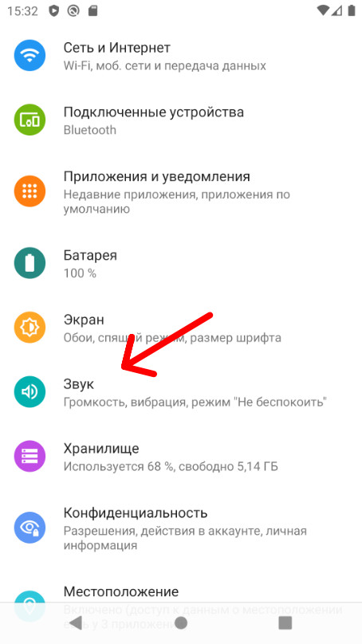

Выбираем пункт &laquo;Рингтон&raquo;, и видим список различных групп(в&nbsp;зависимости от&nbsp;производителя) с&nbsp;рингтонами:

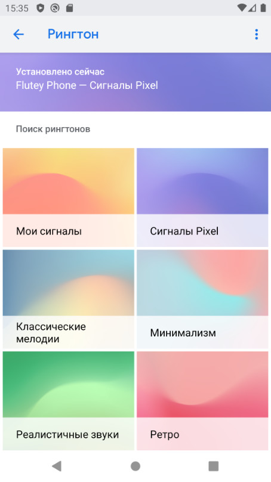

Выбираем любой понравившийся рингтон(при выборе звуковой сигнал начинает проигрываться) и жмем &laquo;Сохранить&raquo;.

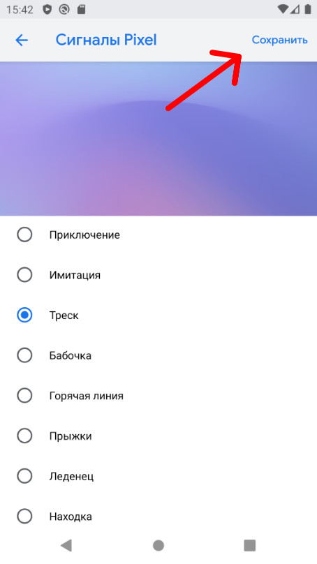

<h2 id="kak-pomenyat-standartnuyu-melodiyu-na-svoyu">Как поменять стандартную мелодию на свою</h2>

Переходим в &laquo;Настройки&raquo; далее &laquo;Звук&raquo; и выбираем раздел &laquo;Рингтон&raquo;, нас интересует раздел &laquo;Мои сигналы&raquo;:

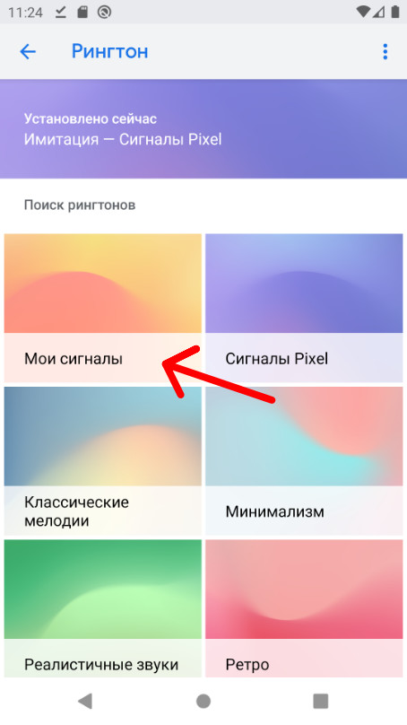

Заходим туда и видим в нижнем правом углу экрана будет кнопка с &laquo;+&raquo;, нажимаем ее:

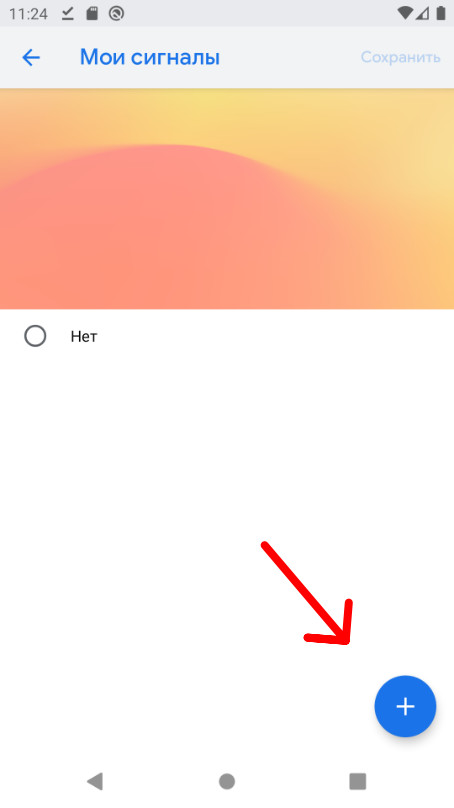

Откроется приложение &laquo;Загрузки&raquo;, будет показаны последние загрузки(вы должны скачать отдельно рингтоны), выбираем нашу скачанную мелодию:

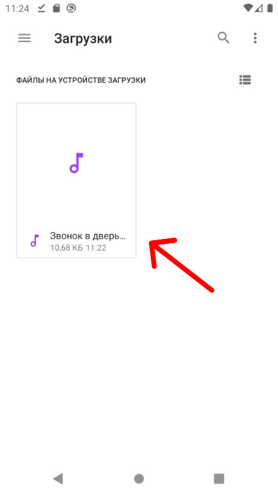

И видим наша мелодия отобразилась в списке &laquo;Мои сигналы&raquo;, выбираем ее и сохраняем.

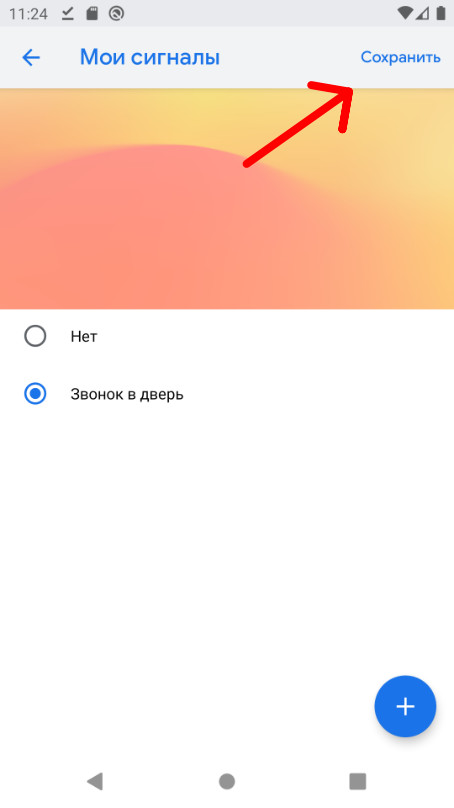

<h2 id="kak-zadat-melodiyu-na-otdelnyy-kontakt">Как задать мелодию на отдельный контакт</h2>

Для того чтобы задать особый рингтон на контакт, нужно открыть приложение &laquo;Контакты&raquo;:

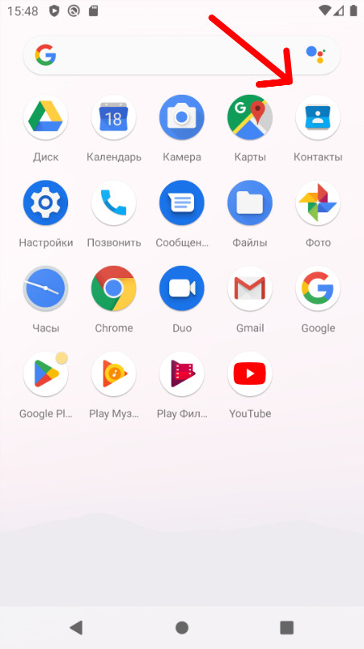

Выбираем нужный контакт из списка:

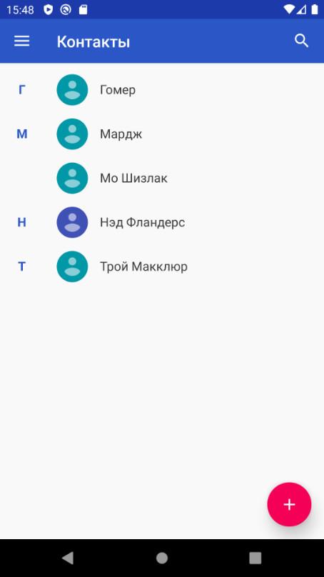

Далее ищем кнопку с тремя точками и нажимаем ее:

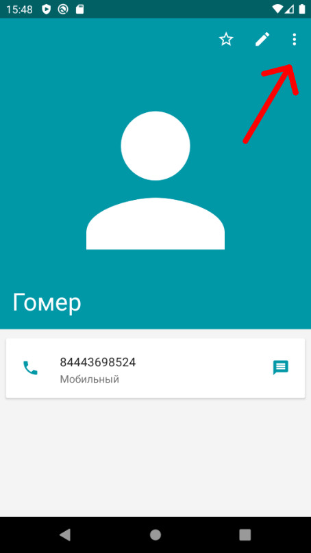

Появится меню в котором нужно выбрать &laquo;Задать рингтон&raquo;:

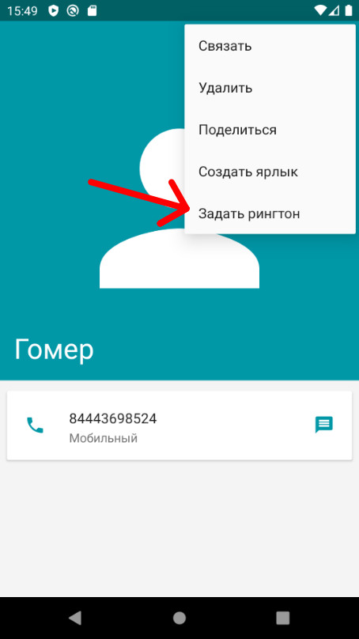

Открывается меню со всеми установленными рингтонами, в котором выберите любой рингтон и нажмите &laquo;Сохранить&raquo;:

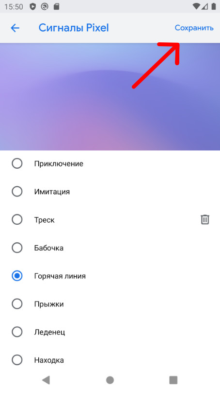

<h2 id="kak-pomenyat-rington-na-ustroystvah-samsung-galaxy">Как поменять рингтон на устройствах Samsung Galaxy</h2>

Для того чтобы поменять звуковой сигнал на устройствах Самсунг нужно зайти в &laquo;Настройки&raquo;, далее выбрать пункт &laquo;Звук и&nbsp;вибрация&raquo;:

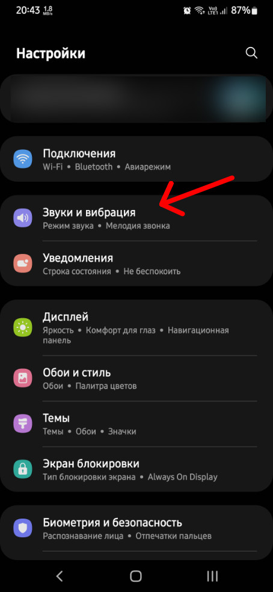

Затем выбираем раздел &laquo;Мелодия звонка&raquo;:

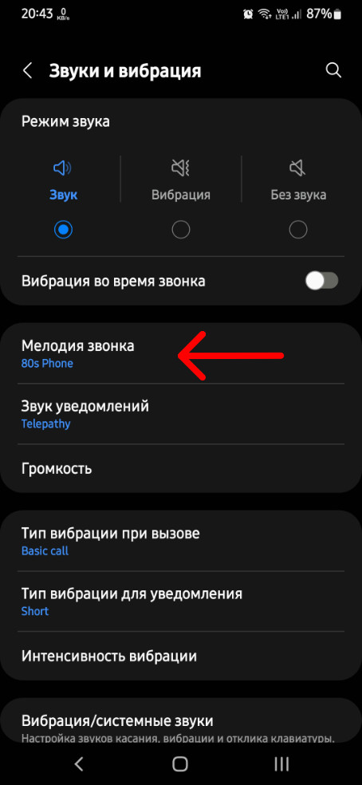

Сразу открывается список всех установленных рингтонов, прослушиваем и выбираем понравившийся:

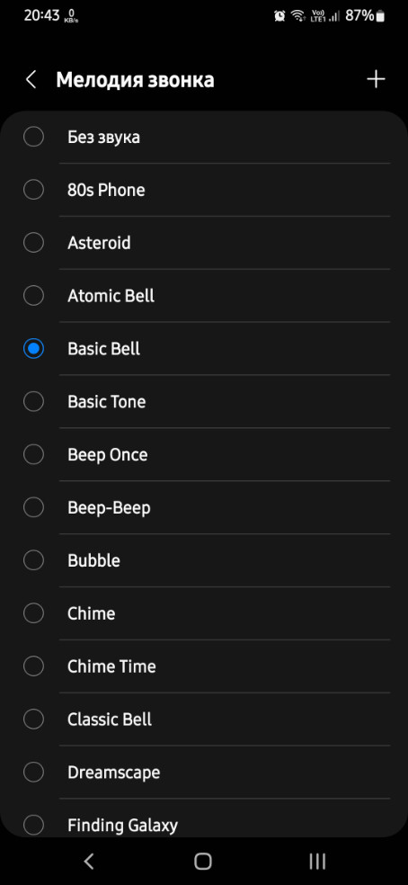

<h2 id="kak-ustanovit-svoy-rington-na-ustroystvah-samsung-galaxy">Как установить свой рингтон на устройствах Samsung Galaxy</h2>

После того как вы скачали рингтон или хотите установить из уже имеющейся библиотеки нужный звуковой сигнал, необходимо зайти в &laquo;Настройки&raquo;&nbsp;&mdash; &laquo;Звук и&nbsp;вибрация&raquo;&nbsp;&mdash; &laquo;Мелодия звонка&raquo;:

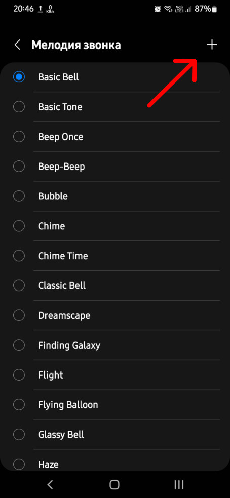

В открывшемся списке мелодий будет кнопка с &laquo;+&raquo;, нажимаем ее и открывается список всех мелодий в вашем устройстве, выбираем нужный рингтон и нажимаем &laquo;Готово&raquo;:

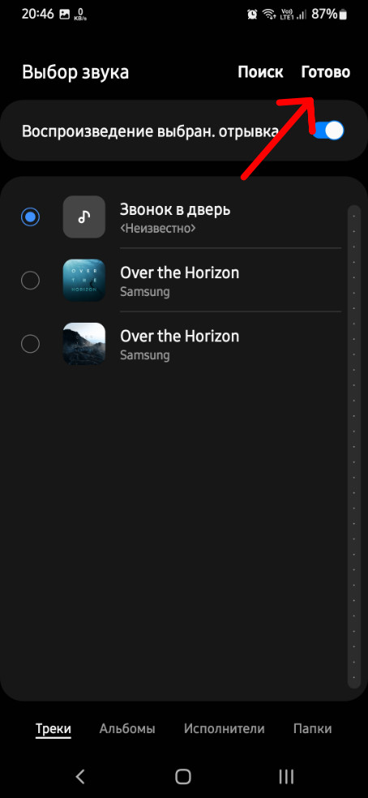

И видим как установился наш звонок:

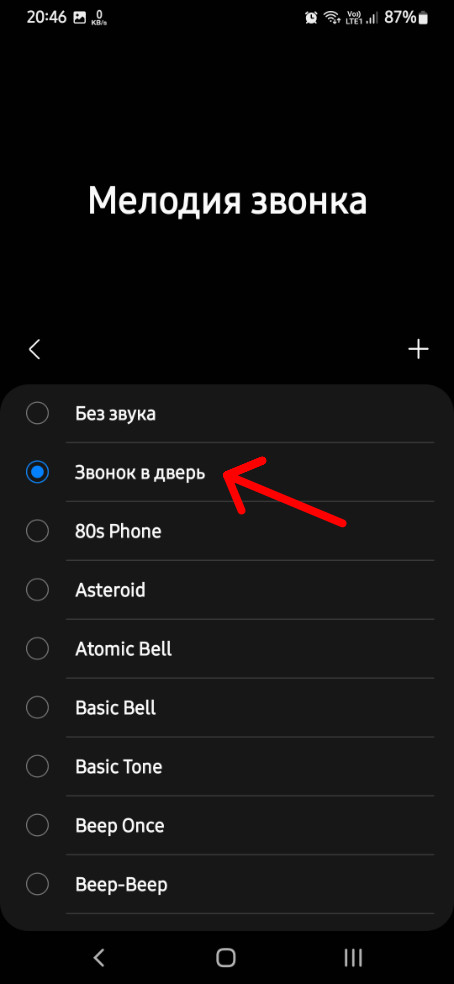

<h2 id="kak-ustanovit-melodiyu-na-kontakt-v-ustroystvah-samsung-galaxy">Как установить мелодию на контакт в устройствах Samsung Galaxy</h2>

Для того чтобы установить другую мелодию на контакт в устройствах Samsung, необходимо открыть приложение &laquo;Контакты&raquo;, выбрать контакт на который собираемся поставить другой рингтон:

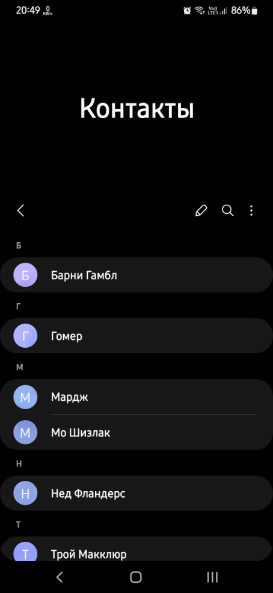
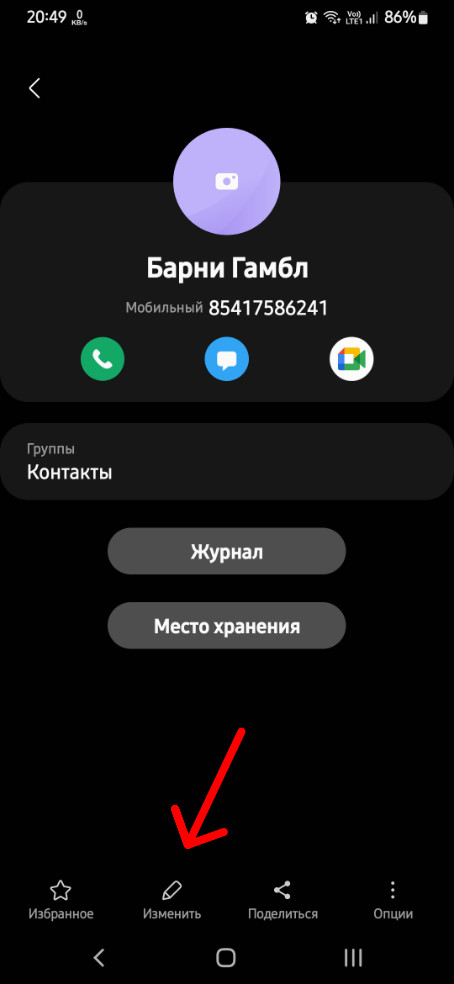

После того как выбрали и нажали на нужный контакт нужно нажать на кнопку с иконкой карандаша и подписью &laquo;Изменить&raquo;, нажимаем на вкладку развернуть:

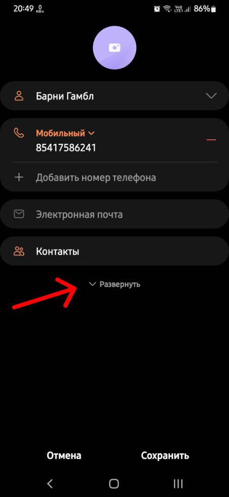

Прокручиваем весь список вниз, нам нужен пункт &laquo;Мелодия звонка&raquo;:

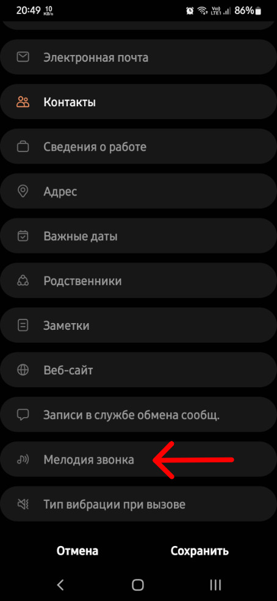

Далее возможно выскочит окошко(если у вас установлены подходящие приложения) с выбором приложения с помощью которого можно выбрать мелодию, в моем примере я выберу стандартное приложение &laquo;SecSoundPicker&raquo;:

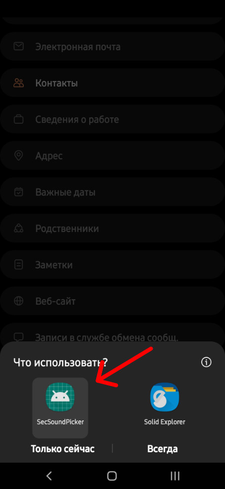

Откроется список всех установленных рингтонов, и выбираем любой который вам понравится:

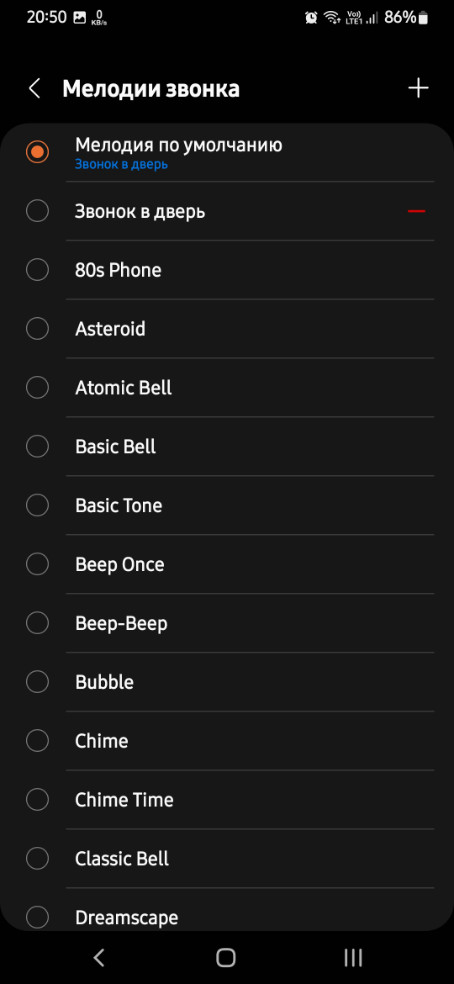

Далее нужно сохранить контакт с добавленной мелодией

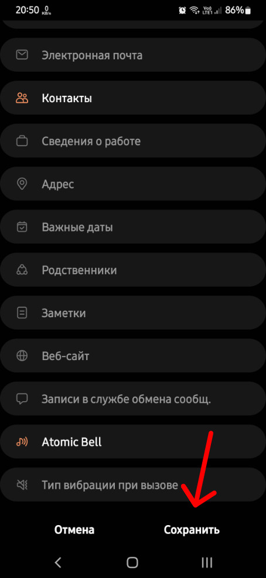

Теперь на отдельном контакте будет особая мелодия, так можно поступить и с другими контактами:

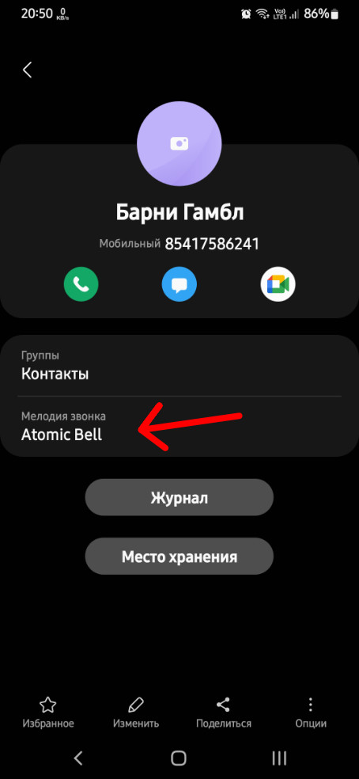

<h2 id="kak-dobavit-svoyu-melodiyu-na-staryh-ustroystvah">Как добавить свою мелодию на старых устройствах</h2>

Если вы пользователь более ранней версии андроид, то возможно у вас так просто нельзя поставить свою мелодию. Для начала нам потребуется файловый менеджер(приложение для просмотра всех файлов и папок на устройстве), большинство производителей предустанавливают в свои смартфоны уже данное приложение, но если вдруг у вас такого нет, то рекомендую скачать с Play Store приложение Google Files:

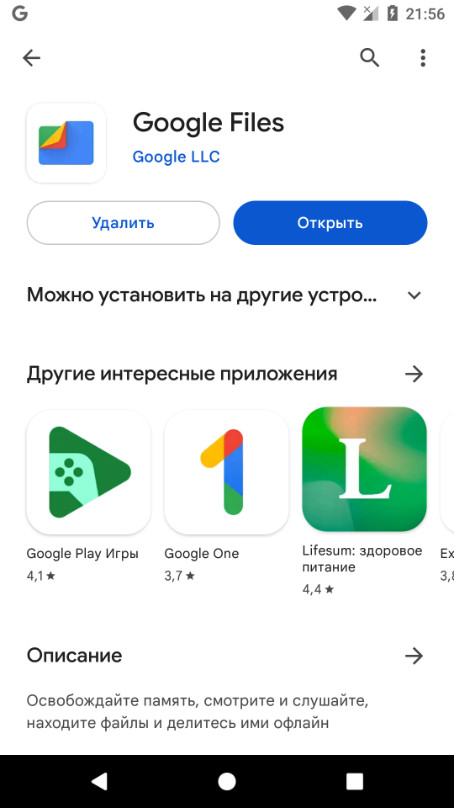

После установки файлового менеджера запускаем его даем разрешение на использование файловой системы:

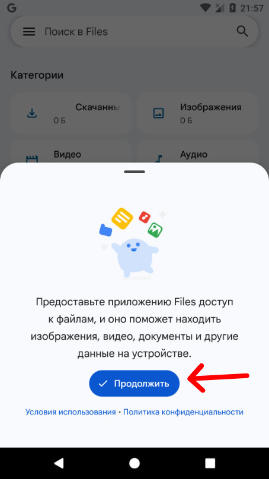
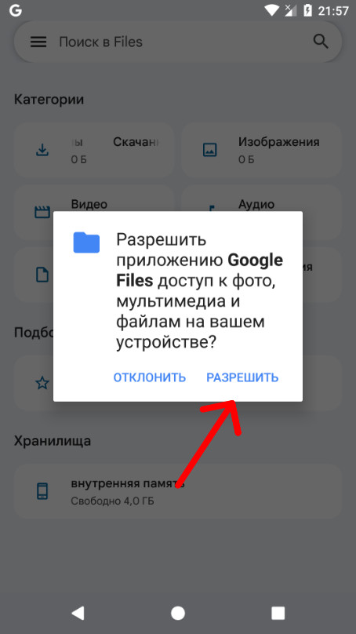

Допустим вы уже скачали рингтон с Интернета, в разделе &laquo;Скачанные файлы&raquo; будет лежать файл рингтона, перейдем в эту категорию:

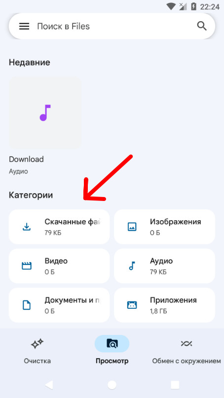

Видим скачанный рингтон, справа будет кнопка с тремя точками и нажмем ее:

Откроется меню, выбираем или &laquo;Копировать в&raquo; или &laquo;Переместить в&raquo;:

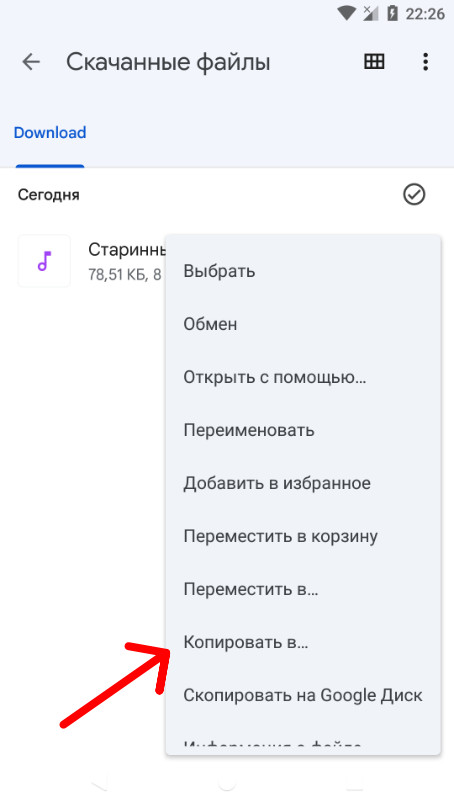

Далее всплывает окошко куда мы хотим перенести наш рингтон, выберем &laquo;Внутренняя память&raquo;:

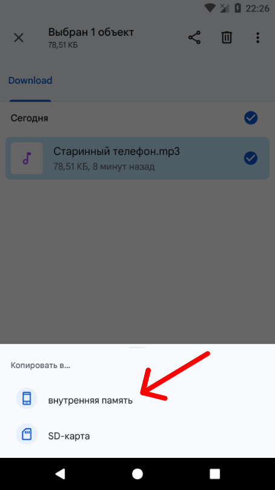

Почти в каждом андроиде есть в корне внутренней памяти есть три папки: &laquo;Alarms&raquo;(Сигналы), &laquo;Notifications&raquo;(Уведомления) и&nbsp;&laquo;Ringtones&raquo;(Рингтоны). Для того чтобы мы видели в списке установленных мелодий нашу, нужно переместить нашу скачанную мелодию в папку &laquo;Ringtones&raquo;(Рингтоны):

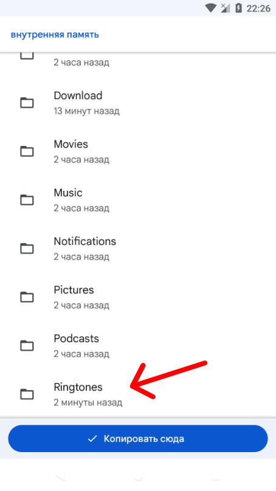
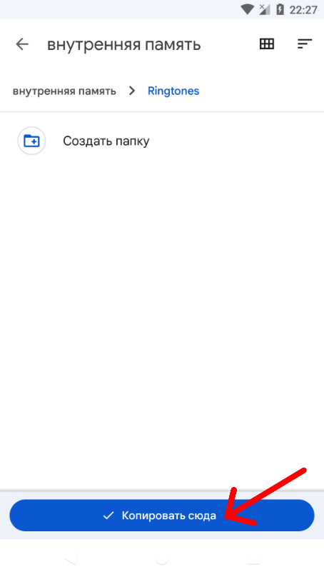

Теперь заходим в настройки устройства&nbsp;&mdash; &laquo;Звук&raquo;&nbsp;&mdash; &laquo;Рингтон&raquo; и видим в списке только что добавленный наш рингтон:

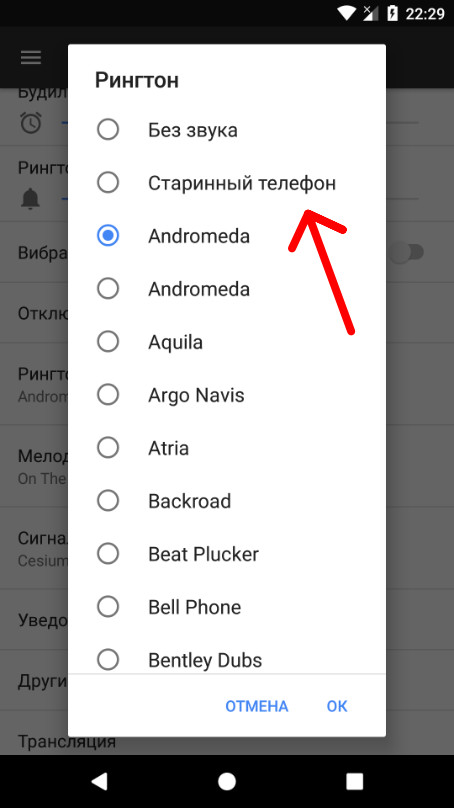

Но что делать если в вашем устройстве нет этих папок(&laquo;Alarms&raquo;, &laquo;Notifications&raquo; и&nbsp;&laquo;Ringtones&raquo;). Для этого нам понадобится тот же файловый менеджер. Запускаем &laquo;Google Files&raquo;, вкладка &laquo;Просмотр&raquo; прокручиваем вниз раздел &laquo;Хранилища&raquo;, если у вас установлена флешка, то можно проделать следующие манипуляции и в ней:

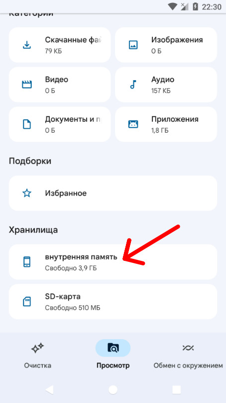

Открываем нужное хранилище, в нижнем правом углу есть кнопка с &laquo;+&raquo; нажимаем на&nbsp;нее и&nbsp;создаем новую папку &laquo;Media&raquo;:

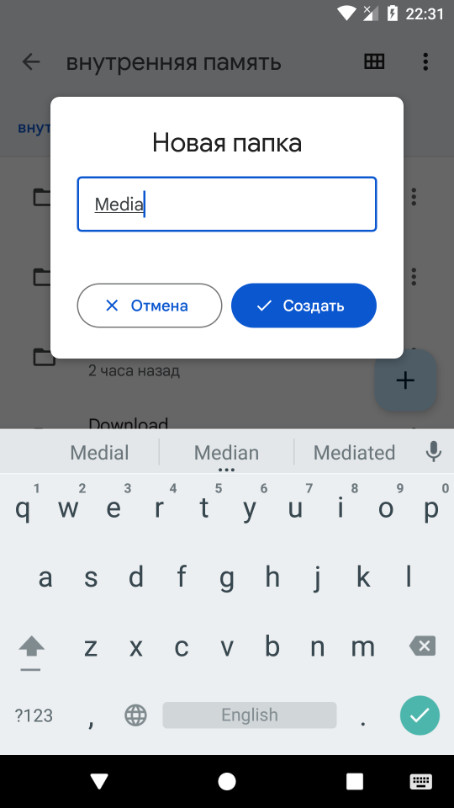

Внутри этой папки создадим еще одну папку &laquo;Audio&raquo;, переходим в&nbsp;нее и&nbsp;создадим внутри еще три папки &laquo;Alarms&raquo;, &laquo;Notifications&raquo; и&nbsp;&laquo;Ringtones&raquo;:

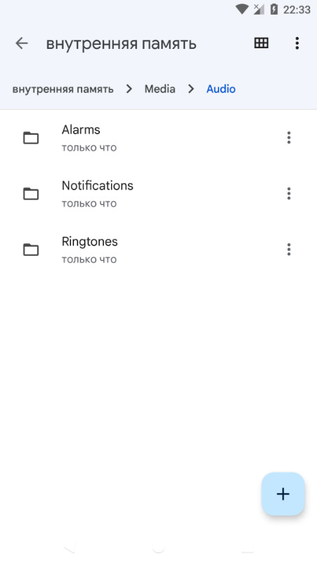

Теперь чтобы система увидела наш рингтон, нужно перенести его в папку &laquo;Ringtones&raquo;(Рингтоны). О том как изменить звонок телефона, поставить на контакт рассказано в статье выше.
