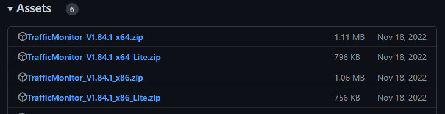
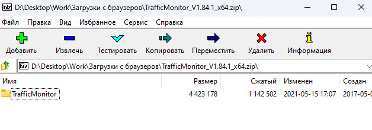
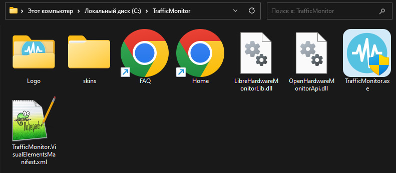
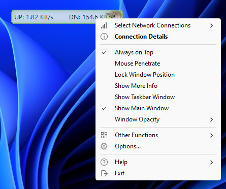
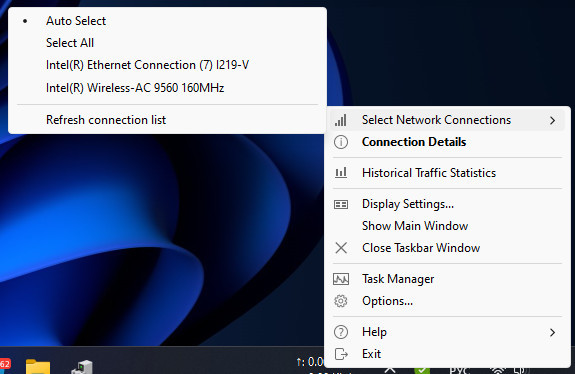

Индикатор скорости Интернета в панели задач Windows показывает текущую скорость загрузки и отдачи данных. Это полезно при скачивании файлов или просмотре видео онлайн. Также помогает определить проблемы с интернет-соединением.

Для этого нам понадобится программа <strong>TrafficMonitor</strong>. Скачать ее можно с сайта <a href="https://github.com/zhongyang219/TrafficMonitor" rel="nofollow noopener" target="_blank">github.com</a>. Далее в боковой панели будет раздел &quot;Releases&quot; в которой видим последнюю версию программы на момент написания статьи - v1.84.1. Затем жмем на ссылку последней версии

В разделе &quot;Assets&quot; выбираем нужную версию в зависимости от разрядности вашей системы(как узнать разрядность системы: правой кнопкой мыши на кнопке &quot;Пуск&quot; - выбираем пункт &quot;Система&quot; - открывается окно &quot;О системы&quot; - откройте раздел &quot;Характеристики устройства&quot; - в таблице характеристик на строке &quot;Тип системы&quot; будет указана разрядность вашей операционной системы) в моем случае: 64-разрядная операционная система значит я буду скачивать &quot;TrafficMonitor_V1.84.1_x64.zip&quot;. Если у вас будет указана 32-разрядная(x86), то скачивайте &quot;TrafficMonitor_V1.84.1_x86.zip&quot;

После того как скачали архив с программой открываем его и видим в нем папку:

Теперь нам нужно извлечь ее на наш диск, я извлеку папку в корень диска C:/.

Мы скачали программу теперь будем её настраивать. Заходим в папку &quot;TrafficMonitor&quot; и запускаем его кликая на &quot;TrafficMonitor.exe&quot;

Появляется такое плавающее окошко:

Не переживайте, далее мы настроим его и будет красиво и аккуратно. Нажимаем правой кнопкой мыши по этому плавающему окошку, выбираем пункт &quot;Show Taskbar Window&quot;

А с пункта &quot;Show Main Window&quot; наоборот снимите галочку(плавающее окошко исчезнет).

Теперь на панеле задач аккуратно установлен индикатор скорости. Далее чтобы программа запускалась каждый раз с включением компьютера отметим это в настройках. Жмем на панеле задач по индикатору и выбираем пункт &quot;Options&quot;, откроются настройки, нам нужно перейти во вкладку &quot;General Settings&quot; в разделе &quot;Application Settings&quot; ставим галочку на пункте &quot;Auto run when Windows starts&quot; и нажимаем кнопку &quot;OK&quot;. Настроек достаточно много и можно настроить TrafficMonitor под себя.

<h2>Возможные неполадки</h2>

Обычно программа сразу из коробки выбирает правильный сетевой адаптер и показывает скорость, но если вдруг у вас не отображается и все стоит по нулям, то нужно будет выбрать вручную. Кликаем правой кнопкой мыши по индикатору и в самом верху будет пункт &quot;Select Network Connections&quot;, наводим на него мышь и видим все сетевые адаптеры вашего ПК:

Если компьютер подключен по кабелю, выбираем тот адаптер у которого есть слово <strong>Ethernet</strong>, если их несколько выбирайте по очереди, пока не начнет отображать индикатор.

Если компьютер подключен по <strong>Wi-Fi</strong>, ищите адаптер со словом <strong>Wireless</strong>.
