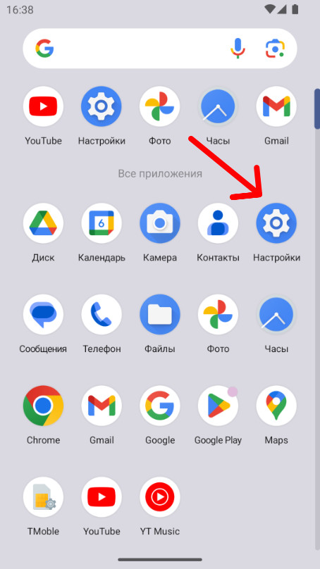
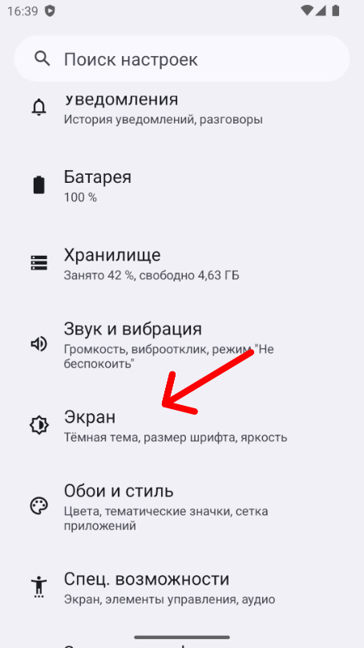
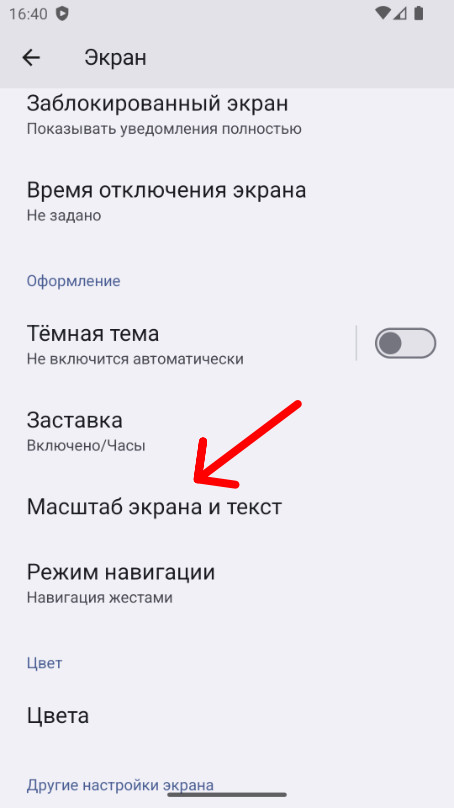
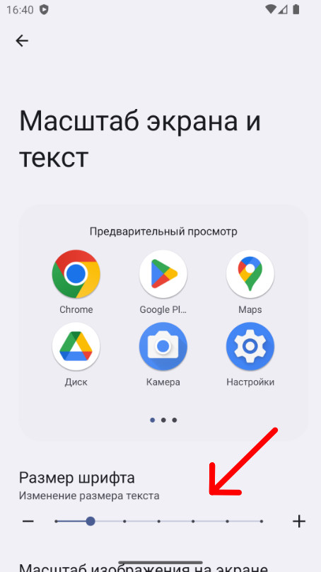
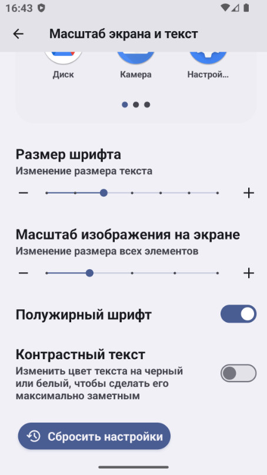
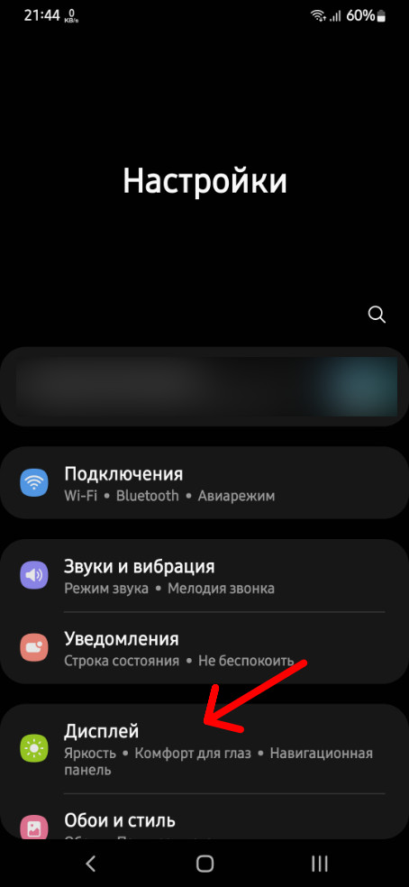
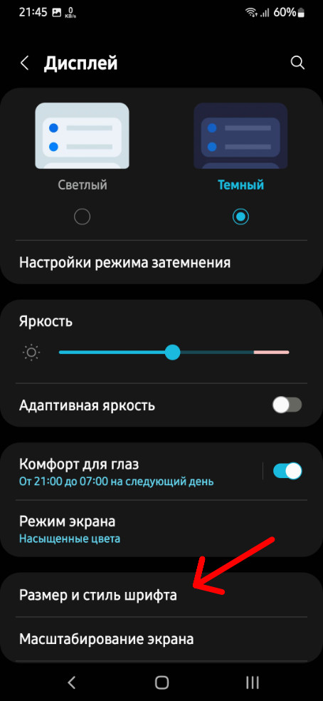
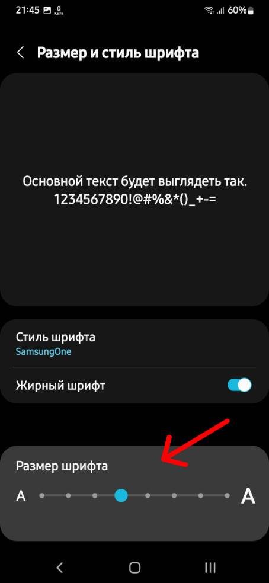

Изменение размера текста на смартфоне позволяет индивидуально настроить устройство, а также помочь людям с ограниченными возможностями получить более комфортный доступ к информации.

Для того чтобы увеличить или уменьшить шрифт, необходимо зайти в настройки:

Прокручиваем вниз до группы настроек &laquo;Экран&raquo; и переходим в нее:

Среди списка различных настроек находим пункт &laquo;Масштаб экрана и текст&raquo; и выбираем его:

И наконец здесь мы можем изменить размер текста нажимая на &laquo;плюс&raquo; если хотим увеличить или на &laquo;минус&raquo; если хотим уменьшить или просто двигая ползунок вправо-влево:

Здесь же в зависимости от производителя устройства можно сделать текст полужирным и контрастным:

<h2>Как изменить размер текста на устройствах Galaxy</h2>

Также заходим в настройки и выбираем &laquo;Дисплей&raquo;:

Далее ищем раздел &laquo;Размер и стиль шрифта&raquo; и переходим в него:

Здесь, чтобы уменьшить или увеличить размер шрифта можно нажать на символ &laquo;А&raquo; малый или большой, а также просто перемещать вправо-влево ползунок:

Некоторые фирмы-производители телефонов дают функцию здесь же поменять шрифт, как например Самсунг, выбрав наиболее подходящий на свой вкус купив или скачав бесплатный.
