
Со временем в играх могут появляться некоторые подергивания или рывки(статтеры), которые мешают насладиться прохождением любимой игры, причин которых может быть множество как проблемы в ПО так и неисправности комплектующих ПК. В данной статье мы рассмотрим пару вариантов которые могут помочь исправить появление рывков в играх на примере видеокарт от NVIDIA.

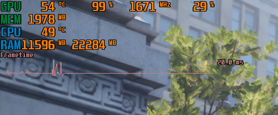

  
Смотрите также:

  <a class="see-also__link" href="/posts/kak-vyvesti-schetchik-fps-v-igrah/">Как вывести счетчик фпс в играх</a>

<h2 id="pervyy-sposob-ochistka-kesha">Первый способ: очистка кэша</h2>

Для начала зайдем в &laquo;Панель управления NVIDIA&raquo;, нажмем правой кнопкой мыши по пустому месту на рабочем столе, если у вас Windows 11, то нужно дополнительно нажать &laquo;Показать дополнительные параметры&raquo; чтобы увидеть этот пункт:

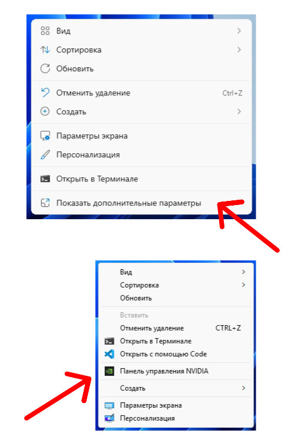

В открывшемся окне в левой колонке найдите &laquo;Параметры 3D&raquo; и выберите &laquo;Управление параметрами 3D&raquo; в правой колонке отобразятся параметры, нам нужно во вкладку &laquo;Глобальные параметры&raquo;, далее нужно прокрутить вниз и найти &laquo;Размер кэша шейдеров&raquo; и установить &laquo;Отключено&raquo; затем применяем настройки, закрываем окно и перезагружаем компьютер.

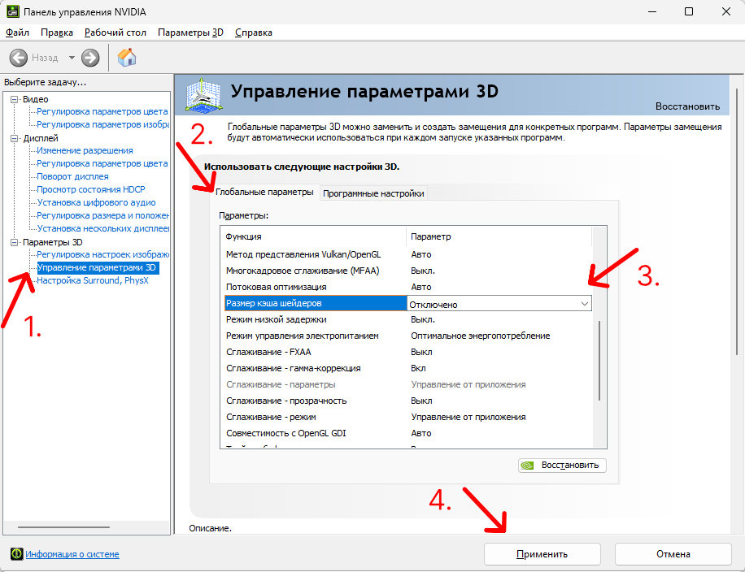

После перезагрузки нужно открыть &laquo;Проводник&raquo; нажав &laquo;Клавиша Windows + латинскую букву E&raquo; и перейти по этому пути: диск на котором установлена система (обычно диск &laquo;C&raquo;) - &laquo;Пользователи&raquo; - &laquo;Здесь выберите нужную папку с именем пользователя&raquo; -  &laquo;AppData&raquo; - &laquo;Local&raquo; - &laquo;NVIDIA&raquo; - &laquo;GLCache&raquo;.

<h2 id="kak-vklyuchit-otobrazhenie-skrytyh-faylov-i-papok">Как включить отображение скрытых файлов и папок</h2>

Если у вас не отображается папка &laquo;AppData&raquo;, то необходимо включить отображение скрытых файлов и папок. Для этого нужно в &laquo;Проводнике&raquo; нажать на кнопку с тремя точками:

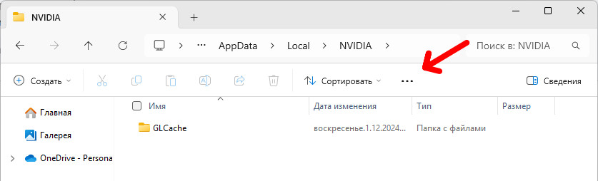

В появившемся окне выбрать &laquo;Параметры&raquo;

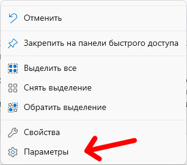

Нажимаем на вкладку &laquo;Вид&raquo;, в дополнительных параметрах прокручиваем вниз и выбираем пункт &laquo;Показывать скрытые файлы, папки и диски&raquo;, нажимаем &laquo;Применить&raquo; и &laquo;ОК&raquo;, теперь у вас будут отображаться скрытые файлы и папки включаю нужную нам &laquo;AppData&raquo;. По этой инструкции вы также сможете отключить показ скрытых файлов.

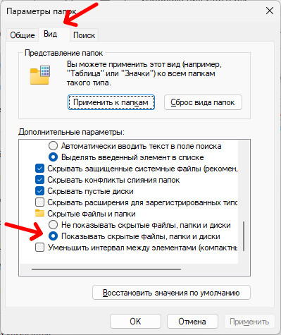

Теперь нам нужно удалить все что находится внутри папки &laquo;GLCache&raquo;. Не закрывая &laquo;Проводник&raquo; переходим в обратно в директорию &laquo;AppData&raquo; кликая в проводнике

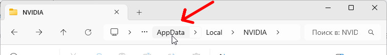

Теперь нужно перейти в &laquo;LocalLow&raquo; - &laquo;NVIDIA&raquo; - &laquo;PerDriverVersion&raquo; - &laquo;DXCache&raquo; и удалить все содержимое в этой папке. Чтобы быстро все выделить и удалить нажмите сочетание клавиш &laquo;Ctrl + A&raquo; и нажмите клавишу &laquo;Delete&raquo; и закрываем окно.

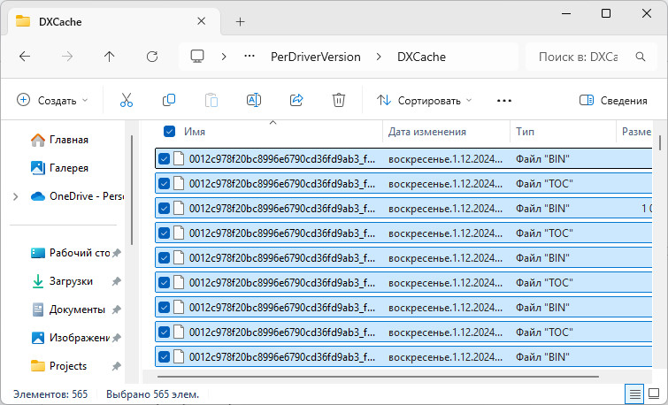

Далее удаляем кэш &laquo;DirectX&raquo;. Для этого нам нужно системное приложение &laquo;Очистка диска&raquo;. Открываем меню &laquo;Пуск&raquo; вводим в строке поиска &laquo;очистка диска&raquo; и открываем приложение

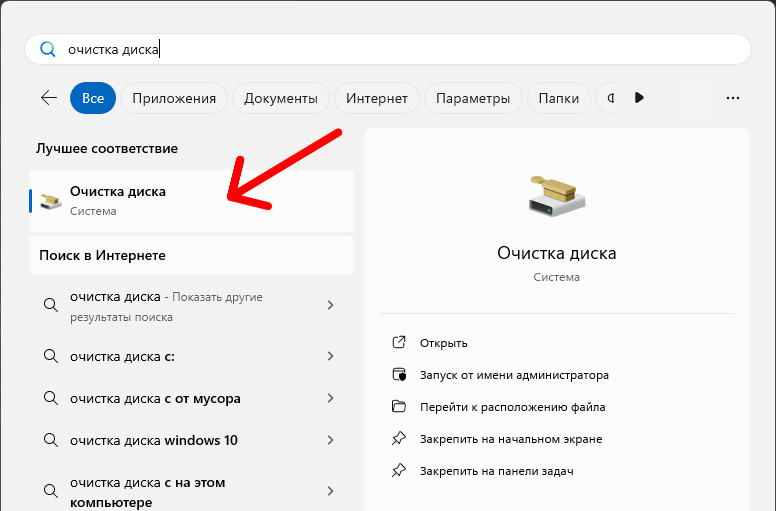

В окне выбираем диск C и жмем &laquo;OK&raquo;

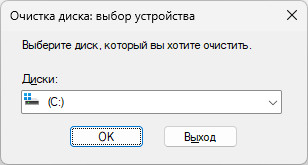

Ставим галочку на пункте &laquo;Кэш построителя текстуры DirectX&raquo;, а со всех остальных снимаем

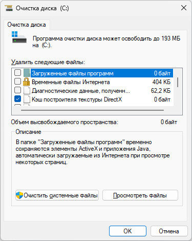

Жмем &laquo;OK&raquo; и соглашаемся с удалением

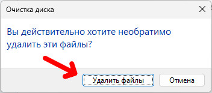

Теперь снова заходим в &laquo;Панель управления NVIDIA&raquo; - &laquo;Управление параметрами 3D&raquo; - &laquo;Размер кэша шейдеров&raquo; и выбрать пункт &laquo;По умолчанию для драйвера" и применяем.

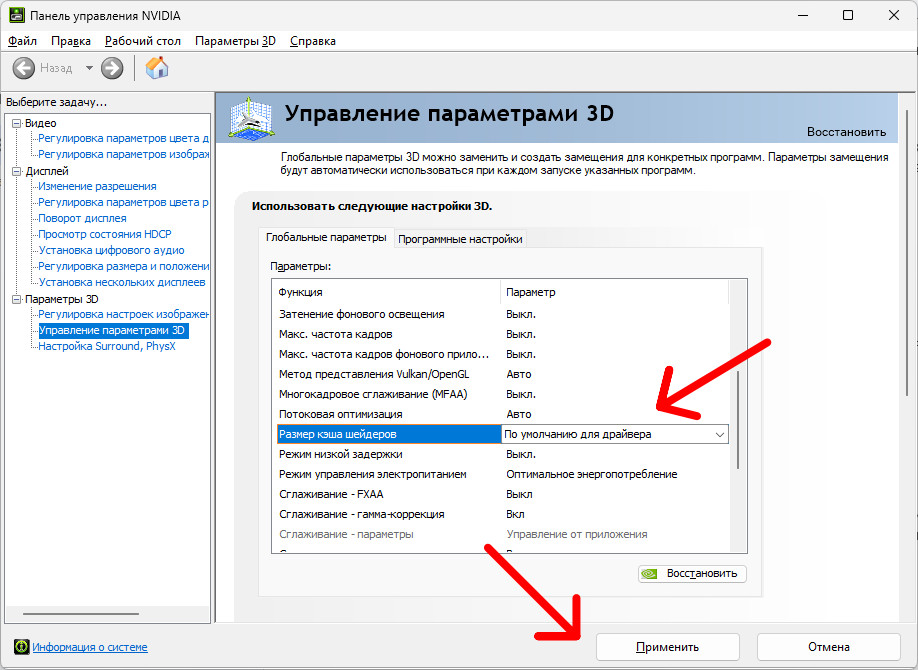

Перезагружаем компьютер, и проверяем в игре стало ли лучше.

<h2 id="vtoroy-sposob-vklyuchenie-fayla-podkachki">Второй способ: включение файла подкачки</h2>

Еще один способ это включить файл подкачки в системе, проверьте включен ли он у вас. Нажимаем правой кнопкой мыши по кнопке &laquo;Пуск&raquo;, затем нажимаем на &laquo;Система&raquo;.

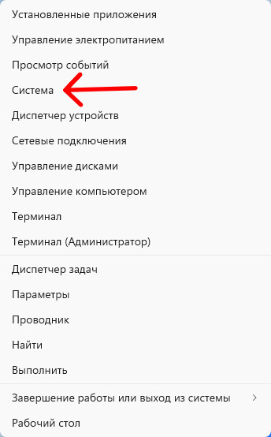

В появившемся окне выбираем &laquo;Дополнительные параметры системы&raquo;

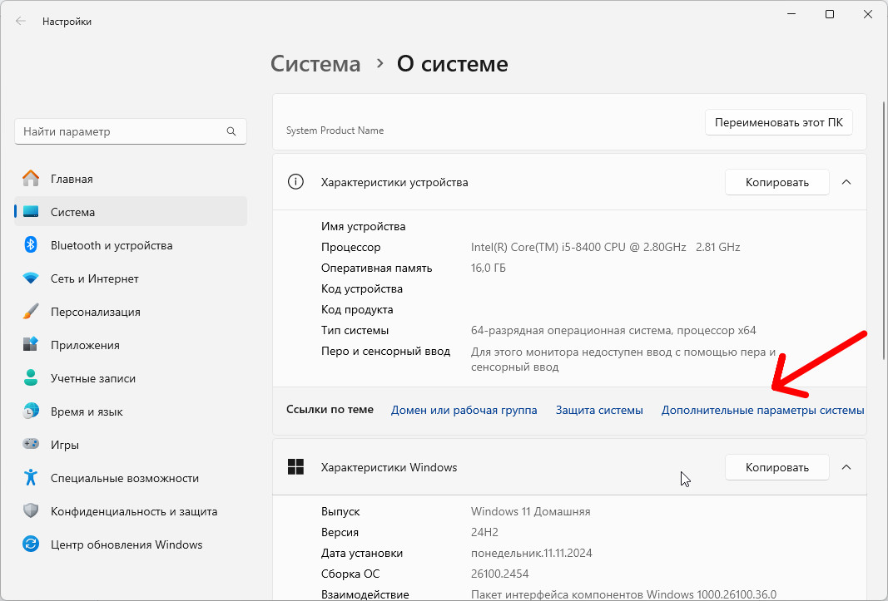

Откроются параметры, далее во вкладке &laquo;Дополнительно&raquo; есть раздел &laquo;Быстродействие&raquo; в котором находится кнопка &laquo;Параметры&raquo; нажимаем ее.

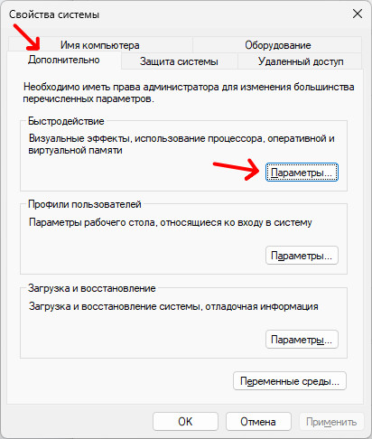

Откроется еще одно окно в котором нам нужно выбрать вкладку &laquo;Дополнительно&raquo;, в разделе &laquo;Виртуальная память&raquo; нажимаем кнопку &laquo;Изменить&raquo;

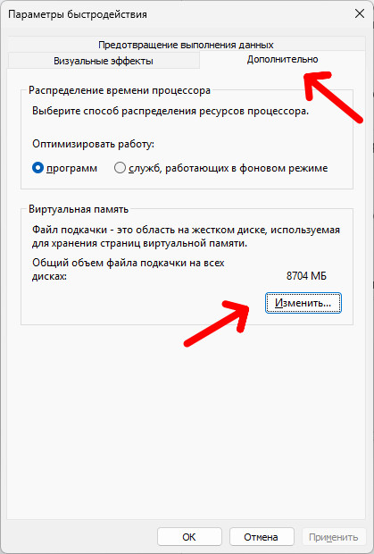

Появляется список дисков в системе и у каждого будет указан размер файла подкачки

<blockquote>Внимание! При создании файла подкачки будет динамически изменяться размер занимаемого места в указанном диске, но также одновременно будет улучшена общая производительность компьютера</blockquote>

Если вдруг у вас не установлен файл подкачки не на одном диске, то нужно будет выбрать любой диск, если выбранный диск будет формата SSD будет еще лучше, далее выбираем пункт &laquo;По выбору системы&raquo;, затем нажимаем кнопку &laquo;Задать&raquo; и &laquo;OK&raquo;.

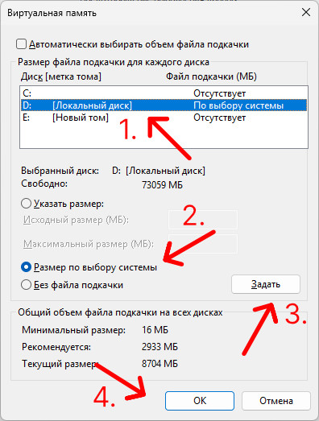

После этого система может попросить перезагрузить ПК, чтобы включить файл подкачки, перезагружаем. После проверяем как ведут себя игры.
