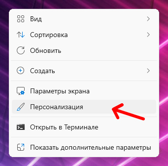
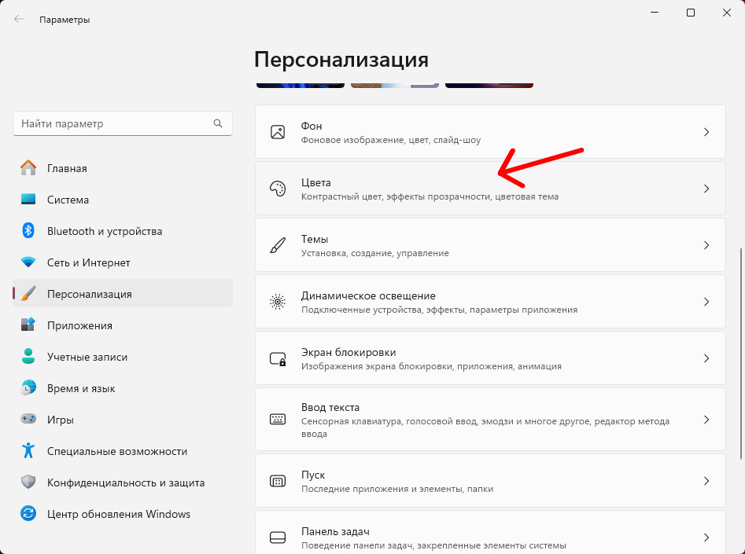
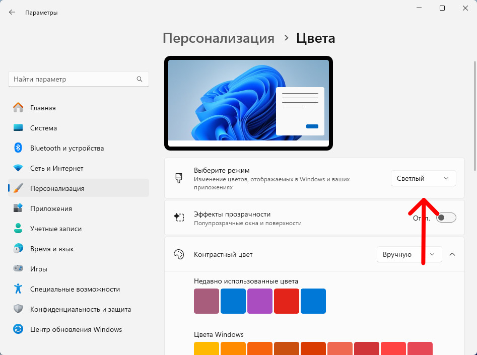
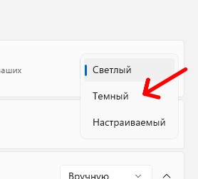
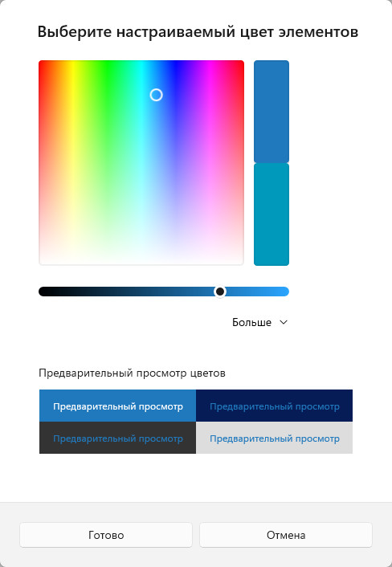
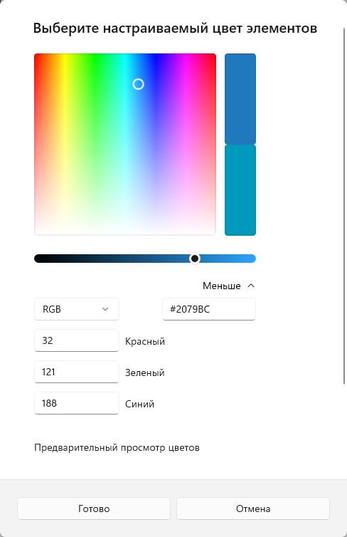
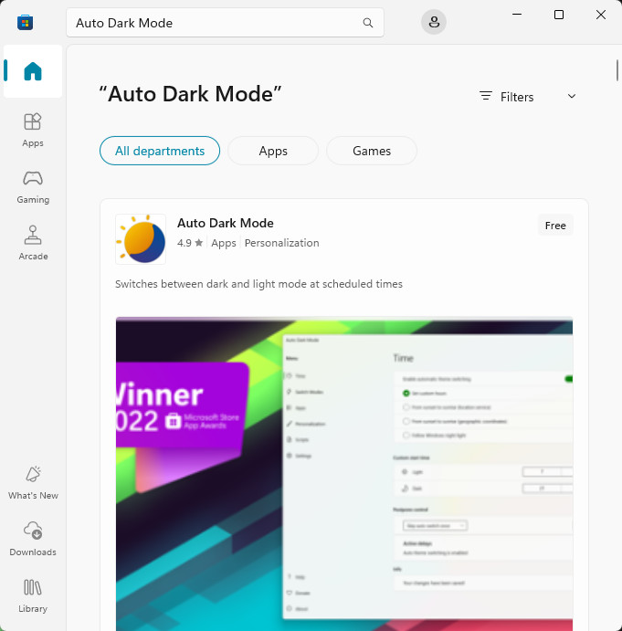
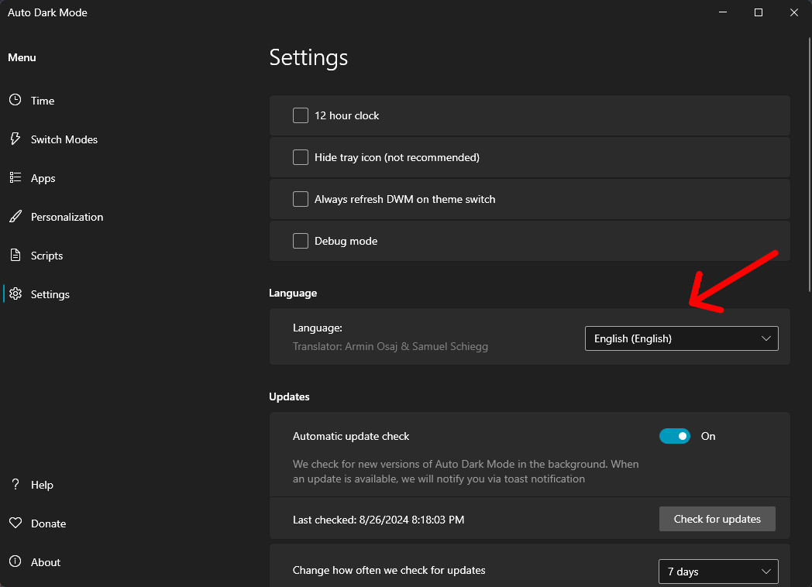
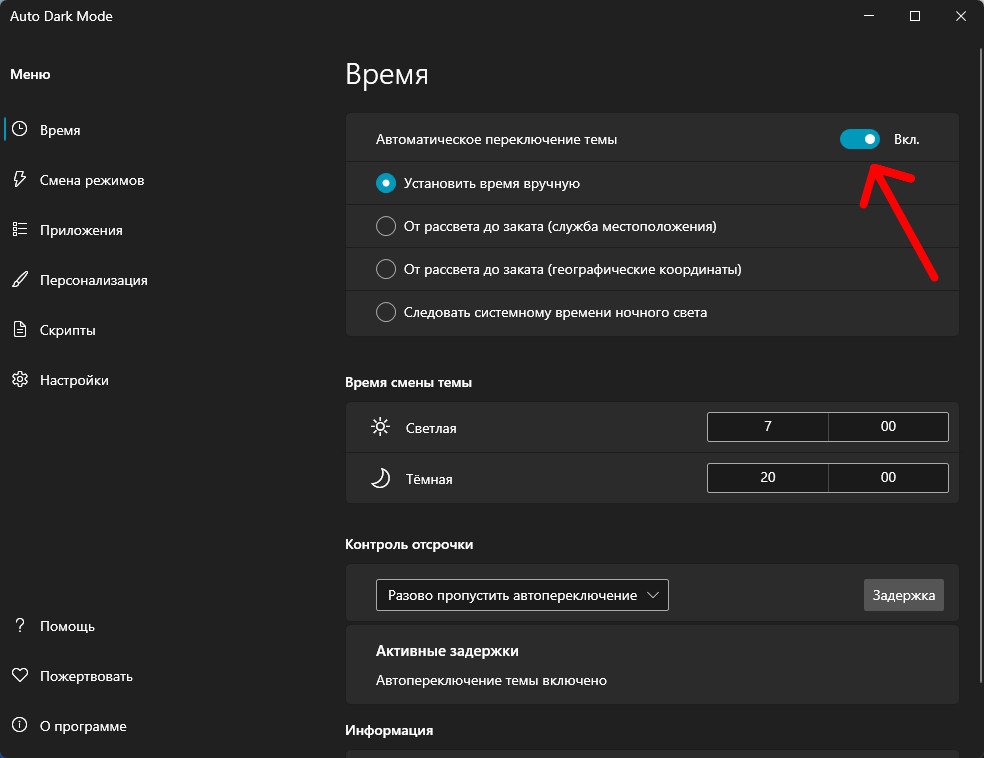
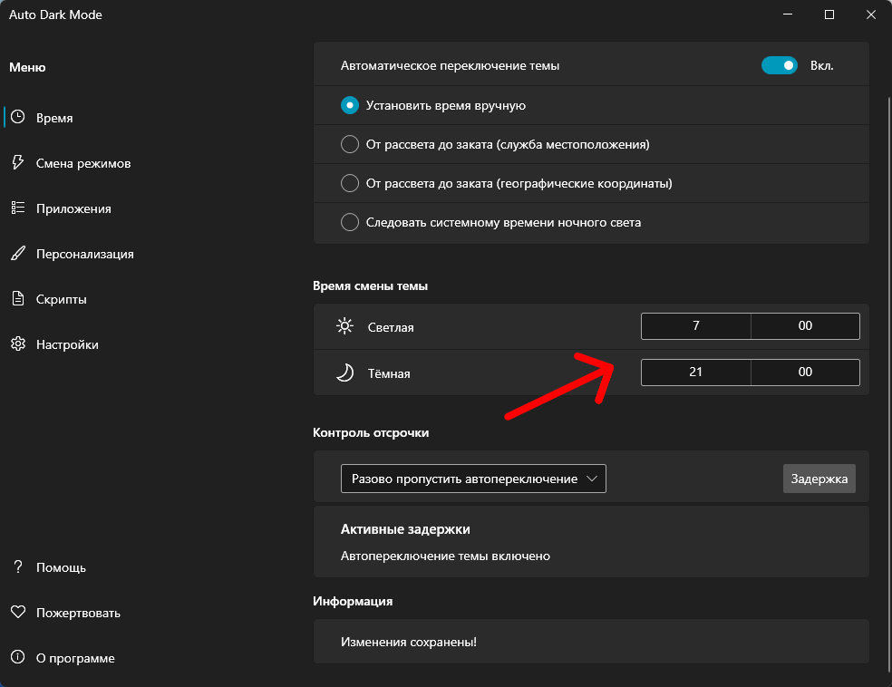

Если вы работали продолжительное время за компьютером, и при этом чувствуете напряжение и усталость глаз, то вам может помочь темная тема. Она позволяет уменьшить нагрузку на глаза, снизить утомляемость в условиях низкой освещенности. При этом многие пользователи предпочитают темный интерфейс из-за его эстетики.

<h2 id="kak-vklyuchit-temnyy-rezhim-v-windows-11">Как включить темный режим в Windows 11</h2>

Нажмите правой кнопкой мыши на рабочем столе, в открывшемся контекстном меню кликните на пункт &laquo;Персонализация&raquo;.

Далее выбрать пункт &laquo;Цвета&raquo;:

В разделе &laquo;Выберите режим&raquo; на нажмите выпадающий список, и выберите &laquo;Темный&raquo;:

Интерфейс системы перекрасится в темные цвета. Также здесь можно будет выбрать акцентный цвет темы в разделе &laquo;Цвета Windows&raquo; или выбрать свой собственный цвет в пункте &laquo;Пользовательские цвета&raquo;.

В появившемся окне цвет можно настроить простым ползунком, но если вы хотите указать точный цвет вы можете его задать в форматах HEX, RGB или HSV, для нужно нажать вкладку &laquo;Больше&raquo; появится дополнительное меню где можно будет ввести свой цвет.

Кроме изменения цвета интерфейса системы, также изменят тему многие встроенные приложения: Проводник, Почта, Магазин приложений, Планировщик задач, Фотографии, Калькулятор, Погода и т.д. Если какое-то нужное вам приложение не поменяло тему, то зайдите в ее настройки выберите тему &laquo;по выбору системы&raquo;.

<h2 id="kak-vklyuchit-temnyy-rezhim-v-windows-10">Как включить темный режим в Windows 10</h2>

Тоже самое как в Windows 11: Кнопка &laquo;Пуск&raquo; -&gt; Кнопка &laquo;Параметры&raquo; -&gt; &laquo;Персонализация&raquo; -&gt; &laquo;Цвета&raquo; -&gt; &laquo;Выбор цвета&raquo; -&gt; &laquo;Темный&raquo;.

<h2 id="kak-ispolzovat-avtomaticheskuyu-smenu-rezhimov-temy">Как использовать автоматическую смену режимов темы</h2>

К сожалению встроенного функционала автоматической смены темы в системе не предусмотрено, но зато можно использовать сторонние приложения. Для этого нам понадобится приложение <a href="https://apps.microsoft.com/detail/xp8jk4hzbvf435?hl=ru-ru&gl=RU" rel="nofollow" target="_blank">Auto Dark Mode</a> разработчика Armin Osaj, заходим в магазин приложений Microsoft Store и вводим в поиске - Auto Dark Mode и скачиваем.

После того как загрузилось приложение запускаем его, если при запуске интерфейс будет на английском языке, то нужно будет зайти в настройки (значок &laquo;шестеренки&raquo;), в разделе &laquo;Language&raquo; есть выпадающий список языков открываем и находим &laquo;Русский&raquo;, потребуется перезапустить приложение.

Теперь самое главное, что нам потребуется для автоматической смены режима темы: установить переключатель &laquo;Автоматическое переключение темы&raquo; в положение &laquo;Включить&raquo;.

В разделе &laquo;Время смены темы&raquo; указываем время когда будет использоваться определенная тема, я указываю для светлой 7:00 утра, а для темной 21:00 вечера, а вы указывайте время которое вам будет удобно.

