
Чтобы вывести счетчик FPS в играх, понадобится бесплатная программа MSI Afterburner, при помощи которой можно не только мониторить загрузку компьютерных комплектующих, но и производить их разгон и делать андервольтинг видеокарт.

<h2 id="ustanovka-msi-afterburner">Установка MSI Afterburner</h2>

Переходим на <a href="https://www.msi.com/Landing/afterburner/graphics-cards" rel="nofollow" target="_blank">этот сайт</a> чтобы скачать программу. На странице загрузки выбирайте финальную версию(Final):

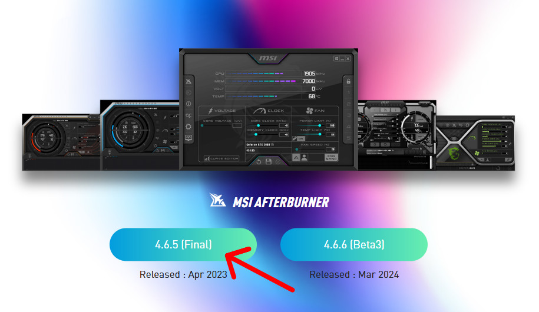

Если эта программа у вас уже установлена, то нажмите на <a href="#nastroyka-msi-afterburner">эту ссылку</a> чтобы сразу перейти к настройке.

После скачивания, нужно разархивировать программу любым архиватором. Далее запускаем установку дважды кликая на иконку установщика. Откроется окно в котором нужно нажать &laquo;Установить&raquo;:

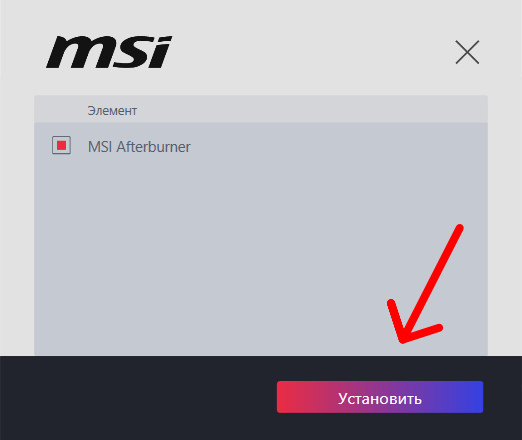

Возможно выскочит окно с предупреждением: &laquo;Разрешить этому приложению вносить изменения на вашем устройстве?&raquo; нажмите &laquo;Да&raquo; если вы скачали MSI Afterburner из проверенного источника по ссылке указанной сверху.

Далее выберите язык на котором вам будет удобнее пользоваться утилитой и нажмите &laquo;OK&raquo;.

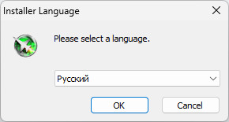

Откроется мастер установки жмем на кнопку &laquo;Далее&raquo;.

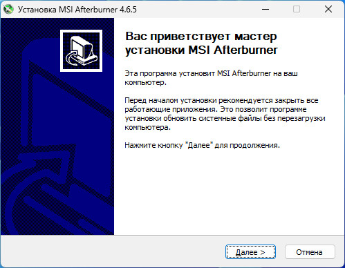

Читаем лицензионное соглашение и выбираем пункт &laquo;Я принимаю условия соглашения&raquo;, нажимаем кнопку &laquo;Далее&raquo;.

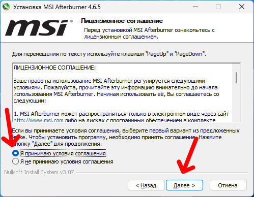

Обязательно проверьте стоит ли галочка на &laquo;RivaTuner Statistics Server&raquo;, если нет поставьте это нужный компонент, который позволяет мониторить ресурсы компьютера. Нажимаем &laquo;Далее&raquo;.

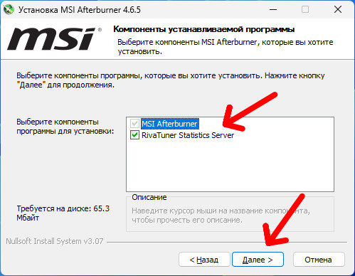

Если необходимо, то укажите место куда хотите установить программу и жмите &laquo;Далее&raquo;.

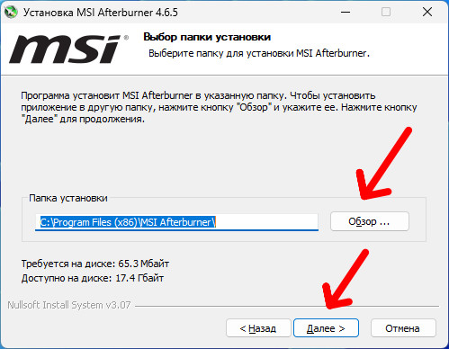

Нажимаем кнопку &laquo;Установить&raquo;.

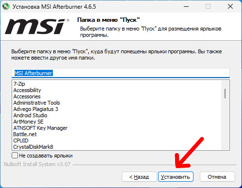

Откроется окно с установкой языка для &laquo;RivaTuner&raquo;, выбираем нужный язык и жмем &laquo;OK&raquo;

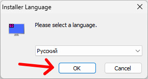

Откроется мастер установки &laquo;RivaTuner Statistics Server&raquo;, жмем &laquo;Далее&raquo;.

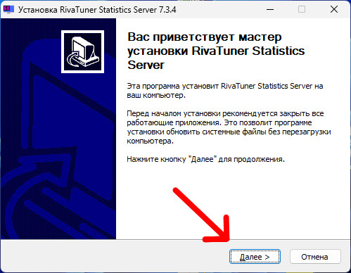

Также принимаем условия соглашения и жмем &laquo;Далее&raquo;.

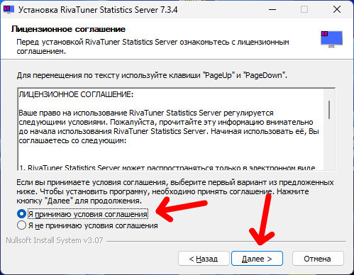

Выбираем папку установки и жмем &laquo;Далее&raquo;.

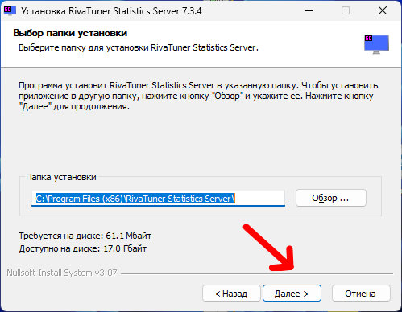

И жмем кнопку &laquo;Установить&raquo;

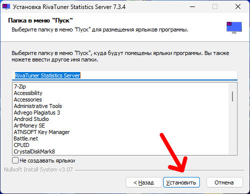

После завершения установки можно снять галочку с &laquo;Показать файл ReadMe&raquo;, и нажимайте &laquo;Готово&raquo;, запустится MSI Afterburner.

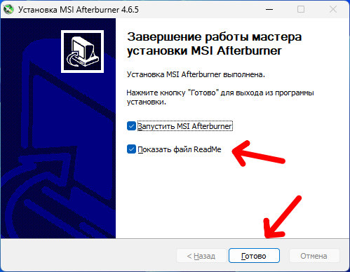

<h2 id="nastroyka-msi-afterburner">Настройка MSI Afterburner</h2>

Затем нажимаем на кнопку с шестеренкой, попадаем в настройки.

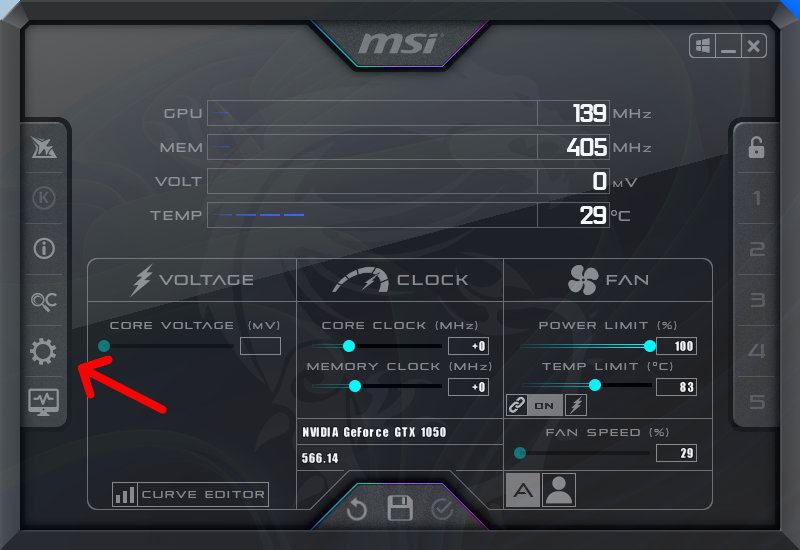

Нас интересует вкладка &laquo;Мониторинг&raquo; и в ней окно со списком сенсоров.

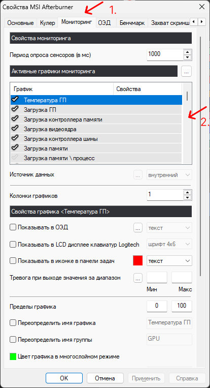

Прокручиваем список ниже до пункта &laquo;Частота кадров&raquo;, по-умолчанию он отключен это видно по галочке слева, она не подсвечивается нам нужно ее активировать нажимаем на нее. Ниже поставьте галочку на пункте &laquo;Показывать в ОЭД&raquo;. Если необходимо можете переименовать отображение имени группы на &laquo;FPS&raquo; чтобы было понятнее и нажмите &laquo;Применить&raquo;, не закрывая программу запускаем любую игру и проверяем.

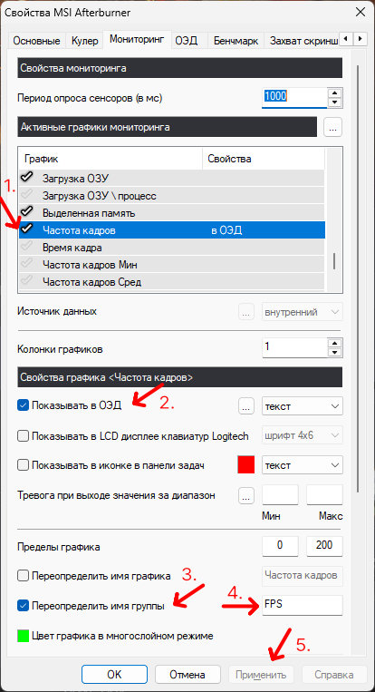

Вот что должно получиться:

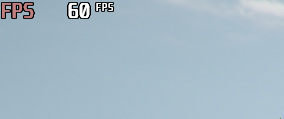

Если вы хотите отобразить еще и график фреймтайма, то справа от &laquo;Показывать в ОЭД&raquo; есть выпадающий список в котором необходимо выбрать &laquo;текст, график&raquo; и нажать &laquo;Применить&raquo;.

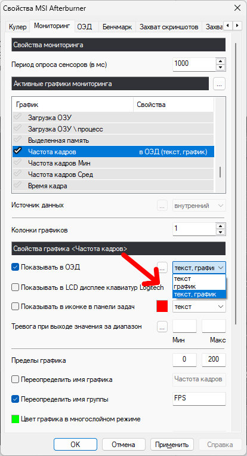

Вот такой график должен появиться:

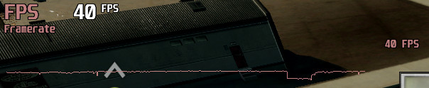

<h2 id="kak-vyvesti-parametry-videokarty">Как вывести параметры видеокарты</h2>

Если необходимо вывести показатели видеокарты в игре, то все также заходим во вкладку &laquo;Мониторинг&raquo; и по списку(&laquo;Температура ГП&raquo;, &laquo;Загрузка ГП&raquo;, &laquo;Загрузка памяти&raquo;, &laquo;Энергопотребление&raquo;) ставим слева активные галочки и у каждого пункта ставим галочку &laquo;Показывать в ОЭД&raquo;.

Пример:

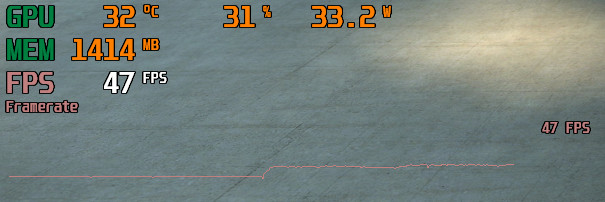

Сейчас все выглядит непонятно и вразброс, но это легко можно исправить. Заходим в настройки - &laquo;Мониторинг&raquo; - кликаем на &laquo;Температура ГП&raquo; и ниже ищем поле &laquo;Переопределить имя группы&raquo; и отмечаем галочкой, затем в поле справа пишем понятное имя(например: &laquo;GPU Temp&raquo;) и так с каждым пунктом(&laquo;Загрузка ГП&raquo; назовем &laquo;GPU Load&raquo;, &laquo;Загрузка памяти&raquo; - &laquo;GPU RAM&raquo;, &laquo;Энергопотребление&raquo; - &laquo;GPU Power&raquo;)

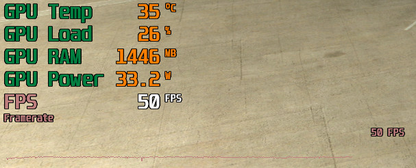

Теперь вся информация встала в колонку и выглядит более информативно.

<h2 id="kak-vyvesti-parametry-protsessora">Как вывести параметры процессора</h2>

Чтобы вывести показатели центрального процессора делаем все тоже самое что и с видеокартой(&laquo;Температура ЦП&raquo;, &laquo;Загрузка ЦП&raquo;, &laquo;Частота ЦП&raquo;, &laquo;Энергопотребление ЦП&raquo;). Названия для списка: (&laquo;Температура ЦП&raquo; - &laquo;CPU Temp&raquo;, &laquo;Загрузка ЦП&raquo; - &laquo;CPU Load&raquo;, &laquo;Частота ЦП&raquo; - &laquo;CPU Clock&raquo;, &laquo;Энергопотребление ЦП&raquo; - &laquo;CPU Power&raquo;).

Вот что получится:

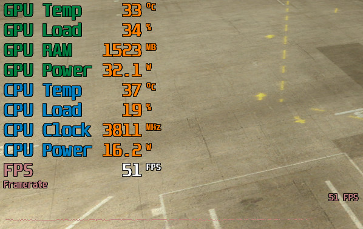

<h2 id="kak-vyvesti-zagruzku-operativnoy-pamyati">Как вывести загрузку оперативной памяти</h2>

Аналогично поступаем и с оперативной памятью. &laquo;Настройки&raquo; - &laquo;Мониторинг&raquo; - ставим галочку на &laquo;Загрузка ОЗУ&raquo; - &laquo;Показать в ОЭД&raquo; - переопределить имя группы в &laquo;RAM&raquo;.

Конечный результат будет выглядеть так:

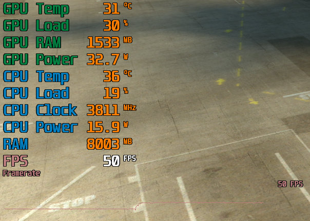

<h2 id="kak-uluchshit-otobrazhenie-monitoringa">Как улучшить отображение мониторинга</h2>

Сейчас мы рассмотрим как увеличить шрифт и включить полупрозрачную подложку. Заходим в трей и находим там значок с монитором и цифрой 60, жмем по ней правой кнопкой и выбираем &laquo;Показать&raquo;

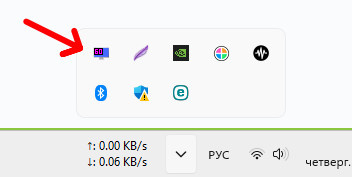

  
Смотрите также:

  <a class="see-also__link" href="/posts/kak-ustanovit-na-panel-zadach-indikator-skorosti-interneta-v-windows-11/">Как установить на панель задач индикатор скорости Интернета в Windows 11</a>

Откроется окно в котором первый пункт на скриншоте установите в положение &laquo;ON&raquo; -  добавляет подложку, а второй пункт это слайдер потяните его вправо или влево и подберите подходящий размер шрифта для себя.

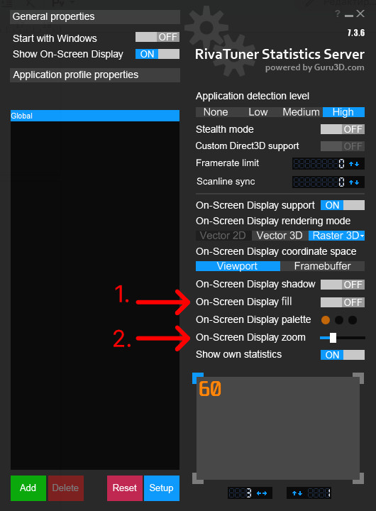