
Со временем после длительного периода использования компьютера, можно заметить что скорость запуска операционной системы может занимать значительное время, особенно если вы часто устанавливаете различные программы. К счастью существует способ ускорить запуск Windows без ее переустановки - отключение ненужных программ из автозагрузки.

<h2 id="kak-otklyuchit-avtozagruzku-programm-v-windows-11">Как отключить автозагрузку программ в Windows 11</h2>

Первый способ через настройки. Нажмите &laquo;Пуск&raquo; - &laquo;Параметры&raquo;:

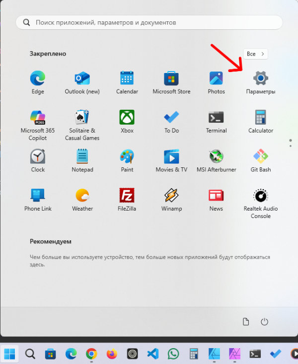

На следующем экране перейдите в раздел &laquo;Приложения&raquo;, затем в &laquo;Автозагрузка&raquo;:

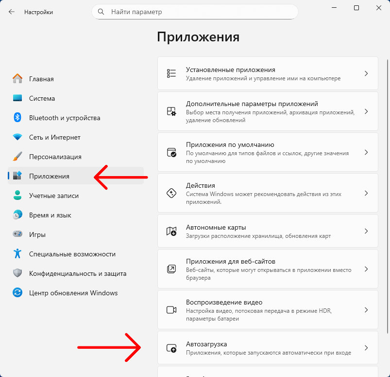

Здесь вы увидите список всех программ которые запускаются одновременно с операционной системой:

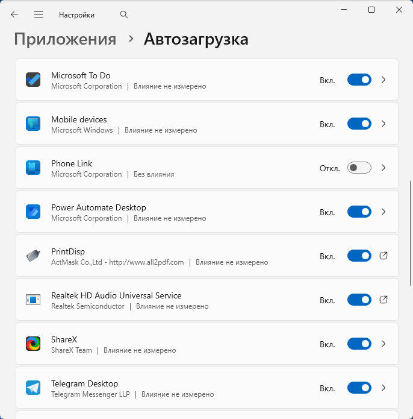

<h2 id="kakie-prilozheniya-mozhno-i-kakie-nelzya-otklyuchat">Какие приложения можно и какие нельзя отключать</h2>

Теперь по поводу какие приложения можно отключать безопасно - мессенджеры, лаунчеры игр, облачные хранилища (Яндекс Диск, Гугл Диск и т.д., но только если не нужны постоянно).

Какие не следует отключать - драйверы, антивирус, системные службы Windows, аудио-драйверы (Realtek и т. п.).

После того как вы определились какие приложения стоит отключить, нажмите на переключатель напротив названия в положение &laquo;Откл.(Отключено)&raquo;.

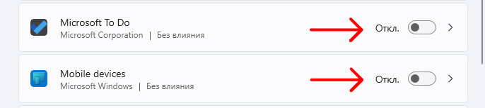

<h2 id="kak-otklyuchit-avtozagruzku-programm-v-windows-11-cherez-dispetcher-zadach">Как отключить автозагрузку программ в Windows 11 через диспетчер задач</h2>

Также можно отключить приложения через &laquo;Диспетчер задач&raquo;, для этого запустим его - нажмите правой кнопкой мыши по кнопке &laquo;Пуск&raquo; или по &laquo;Панели задач&raquo;, в открывшемся меню выберите пункт &laquo;Диспетчер задач&raquo;:

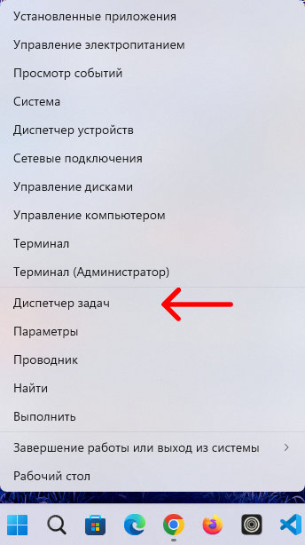

Затем в левом списке параметров нажмите на &laquo;Автозагрузка приложений&raquo;, откроется список приложений:

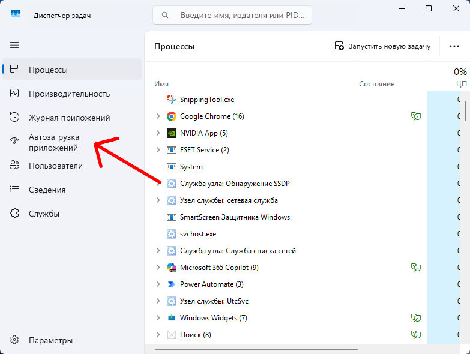

И чтобы отключить необходимо нажать правой кнопкой мыши и выбрать пункт &laquo;Отключить&raquo;:

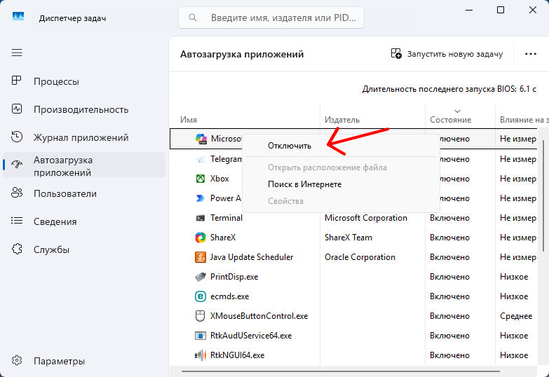

Всё, в следующий раз отключенные приложения не будут влиять на производительность компьютера во время запуска системы. Самое главное выбрать правильно программы для отключения.

<h2 id="kak-otklyuchit-avtozagruzku-programm-v-windows-10">Как отключить автозагрузку программ в Windows 10</h2>

Нажмите &laquo;Пуск&raquo; затем &laquo;Параметры&raquo;:

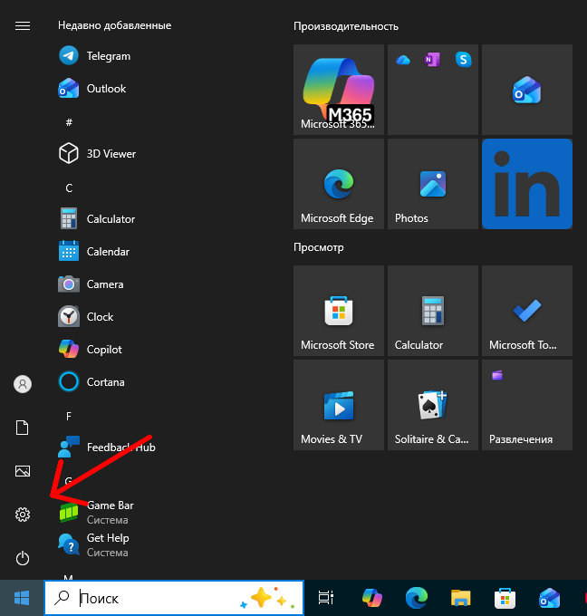

Затем в раздел &laquo;Приложения&raquo;:

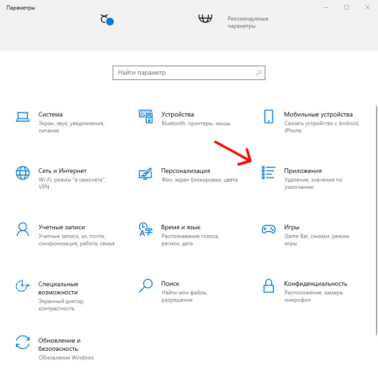

И выберите пункт &laquo;Автозагрузка&raquo;:

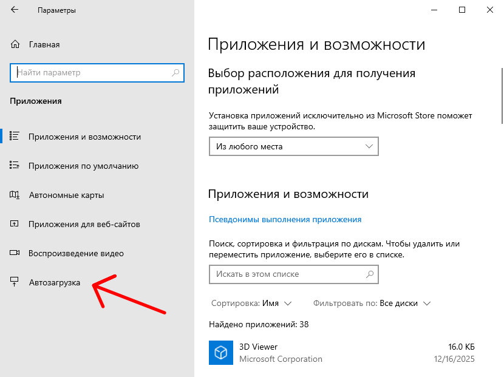

Откроется список приложений которые стартуют вместе с операционной системой о том какие приложения можно отключать безопасно <a href="#kakie-prilozheniya-mozhno-i-kakie-nelzya-otklyuchat">посмотрите здесь:</a>

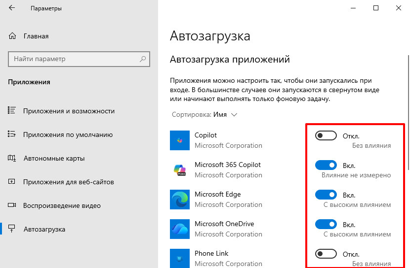

Чтобы выключить из автозагрузки нужное приложение нажмите переключатель из &laquo;Вкл(включено)&raquo; в &laquo;Откл(отключено)&raquo;.

  
Смотрите также:

  <a class="see-also__link" href="/posts/kak-vklyuchit-temnuyu-temu-v-windows/">Как включить темную тему в Windows</a>

<h2 id="kak-otklyuchit-avtozagruzku-programm-v-windows-10-cherez-dispetcher-zadach">Как отключить автозагрузку программ в Windows 10 через диспетчер задач</h2>

Чтобы вызвать &laquo;Диспетчер задач&raquo; нужно кликнуть правой кнопкой мыши по кнопке &laquo;Пуск&raquo; или по панели задач и выбрать пункт &laquo;Диспетчер задач&raquo;:

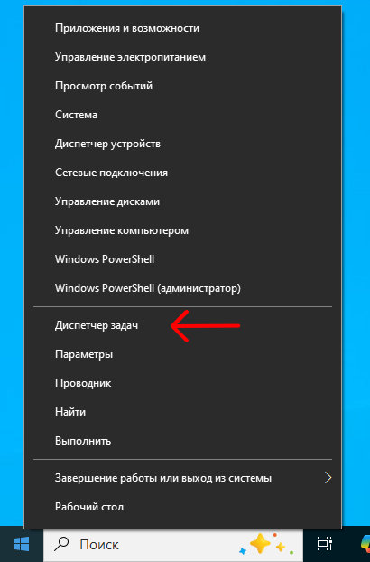

Если у вас показывает пустое окно, то нажмите на кнопку &laquo;Подробнее&raquo;:

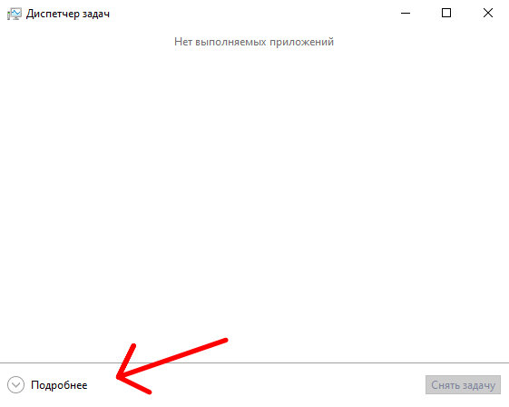

Затем кликните по вкладке &laquo;Автозагрузка&raquo;:

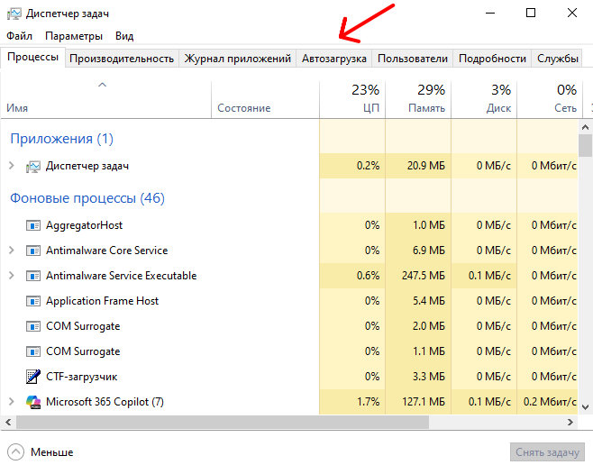

Откроется список всех приложений которые запускаются вместе с системой, и чтобы отключить нужное кликните правой кнопкой мыши и выберите пункт &laquo;Отключить&raquo;:

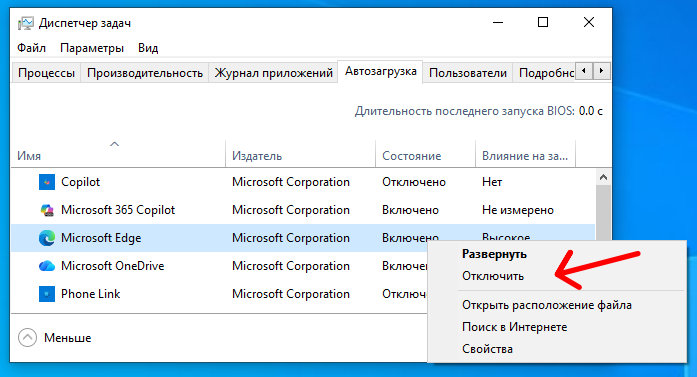

Таким способом можно значительно ускорить готовность операционной системы к работе после включения, особенно на слабом компьютерном железе.
