
В Windows встроены несколько способов создания скриншотов экрана или отдельного окна. Ниже рассмотрены рабочие варианты без установки сторонних программ.

<h2 id="kak-sdelat-skrinshot-v-windows-11">Как сделать скриншот в Windows 11</h2>

Для того чтобы сделать скриншот всего экрана необходимо нажать клавишу Print Screen(PrtScn, PrtSc, PrntScrn), обычно располагается справа от F12. Затем открываем встроенное приложение &laquo;Paint&raquo;, чтобы быстро найти это приложение нажмите &laquo;Пуск&raquo; и в поиске наберите &laquo;paint&raquo; и откройте его:

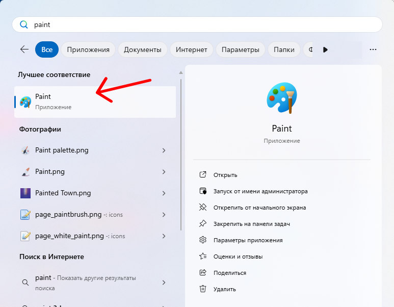

Затем нажмите сочетание клавиш &laquo;Ctrl + V&raquo;,

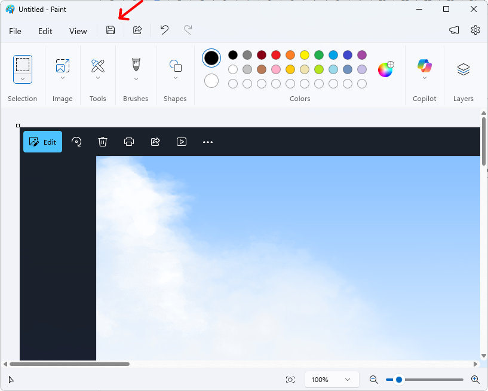

Появится скриншот экрана который можно сохранить в любое место и в нужном формате нажав на кнопку дискеты или нажать сочетание клавиш &laquo;Ctrl + S&raquo;, по умолчанию скриншот сохраняется в формате &laquo;PNG&raquo;, но также можно выбрать и другие &laquo;JPG&raquo;, &laquo;GIF&raquo;, &laquo;HEIC&raquo;, &laquo;BMP&raquo;, &laquo;TIFF&raquo;. Для этого при сохранении выберите нужный формат во вкладке &laquo;Save as Type(Сохранить в формате)&raquo;.

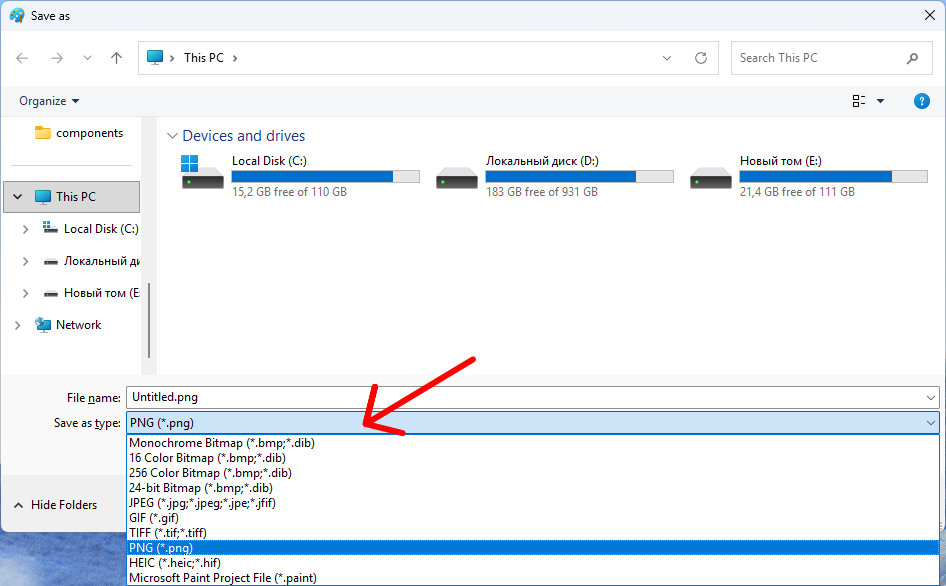

  
Смотрите также:

  <a class="see-also__link" href="/posts/goryachie-klavishi-windows/">Горячие клавиши Windows</a>

<h2 id="kak-sdelat-skrinshot-okna">Как сделать скриншот окна</h2>

Для этого нужно нажать сочетание клавиш &laquo;Alt + Ctrl + Print Screen(PrtScn, PrtSc, PrntScrn)&raquo;. Далее как и в прошлом варианте вставляем клавишами &laquo;Ctrl + V&raquo; в приложении &laquo;Paint&raquo;.

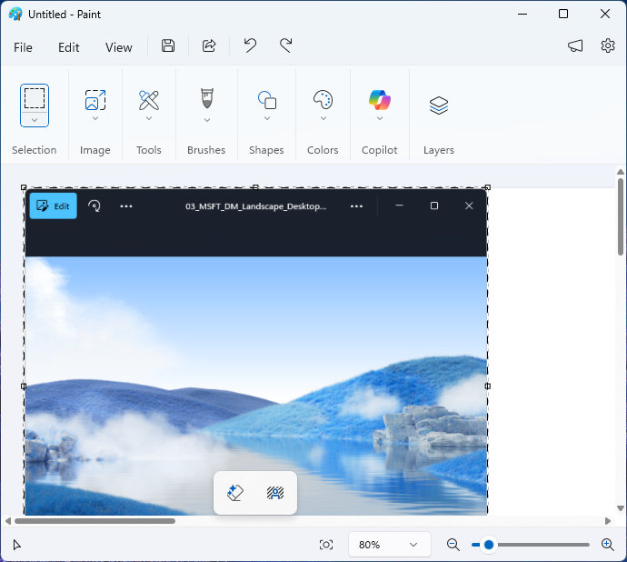

<h2 id="kak-sdelat-skrinshot-esli-na-klaviature-net-klavishi-print-screen">Как сделать скриншот если на клавиатуре нет клавиши - Print Screen</h2>

Для этого понадобится приложение &laquo;Ножницы(Snipping Tool)&raquo;. Чтобы его запустить его также можно найти в меню &laquo;Пуск&raquo;, но есть более быстрый способ вызова это сочетание клавиш &laquo;Shift + Windows + S&raquo;, после откроется приложение с инструментом прямоугольник которым можно выбрать область экрана для сохранения:

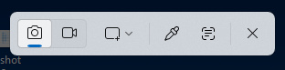

Открывается окно с выделенной областью экрана:

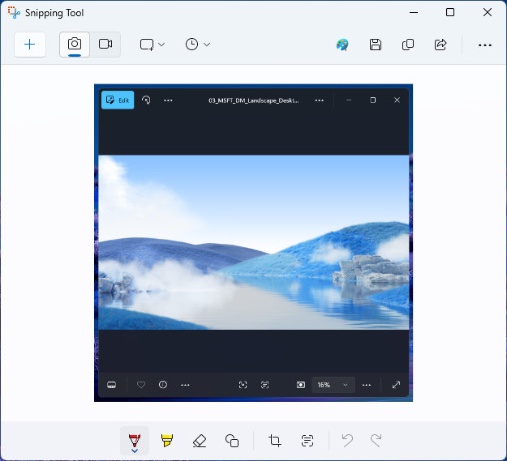

По умолчанию скриншоты сразу сохраняются в папке &laquo;Изображения - Снимки экрана&raquo;, вы можете в этом окне нажать на кнопку с тремя точками и выбрать пункт &laquo;Открыть папку скриншотов&raquo; и взять это изображение, но также можете сохранить это изображение в нужное место кликнув по кнопке с дискетой.

В этом же окне можно сразу выделить нужные объекты карандашом:

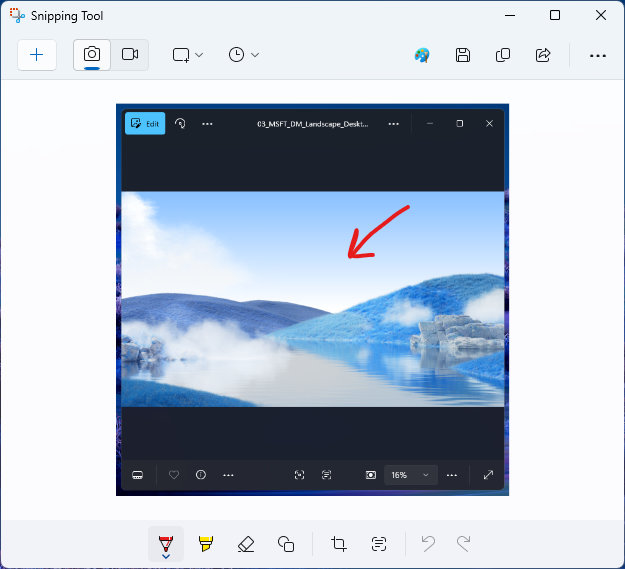

Также использую ножницы можно выбрать в выпадающем меню как вы хотите сделать скриншот - &laquo;Прямоугольник&raquo;, &laquo;Окно&raquo;, &laquo;Весь экран&raquo; или &laquo;Свободную форму&raquo;:

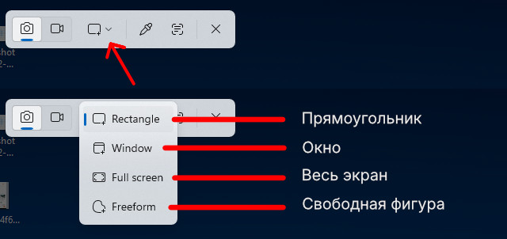

<h2 id="kak-sdelat-skrinshot-v-windows-10">Как сделать скриншот в Windows 10</h2>

Как и в Windows 11 нажимаем клавишу &laquo;Print Screen(PrtScn, PrtSc, PrntScrn)&raquo; и открываем приложение &laquo;Paint&raquo;, нажмите &laquo;Пуск - Стандартные Windows - Paint&raquo; и вставить комбинацией клавиш &laquo;Ctrl + V&raquo;:

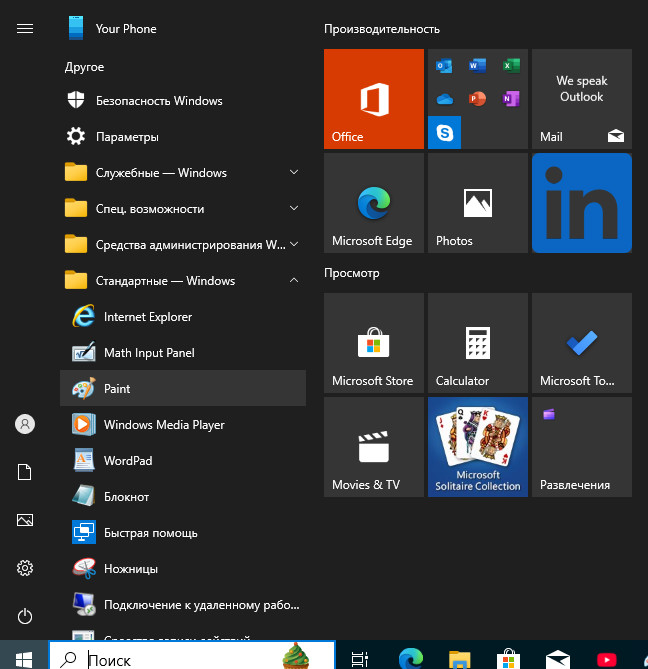

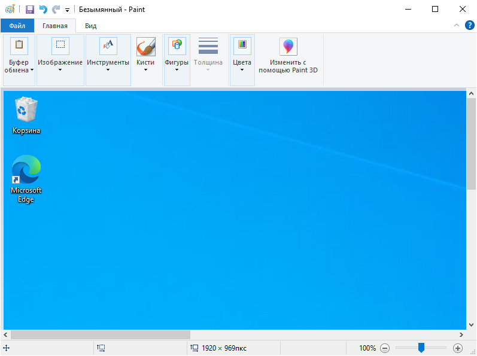

Далее нажмите &laquo;Ctrl + S&raquo; (Сохранить) выбрав формат и место хранения изображения.

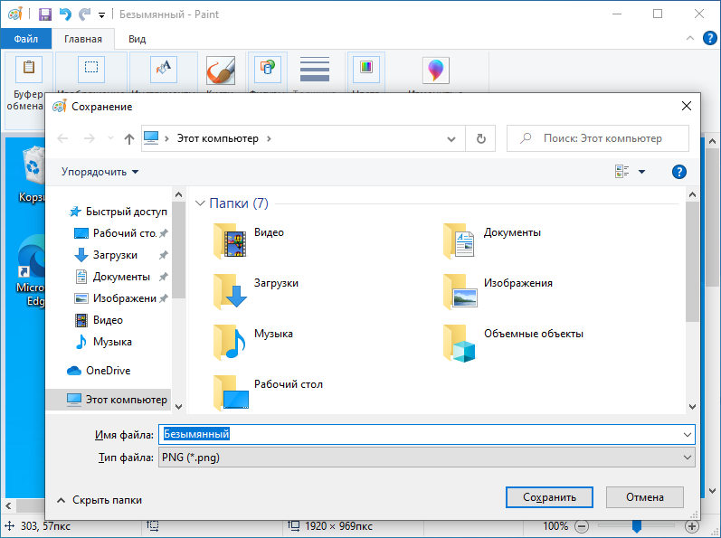

Через приложение &laquo;Ножницы&raquo;

Нажимаем три клавиши - &laquo;Shift + Windows + S&raquo; и открывается приложение в котором несколько пунктов выбора типа скриншота: &laquo;Прямоугольник&raquo;, &laquo;Произвольная форма&raquo;, &laquo;Оконный фрагмент&raquo; и &laquo;Весь экран&raquo;:

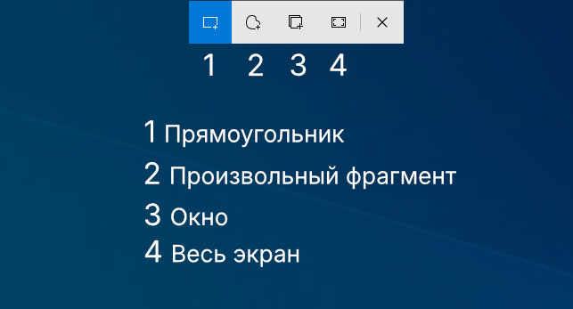

Выбирайте нужный вариант изображения и сохраняйте в нужном формате и месте нажав кнопку с дискетой или &laquo;Ctrl + S&raquo;:

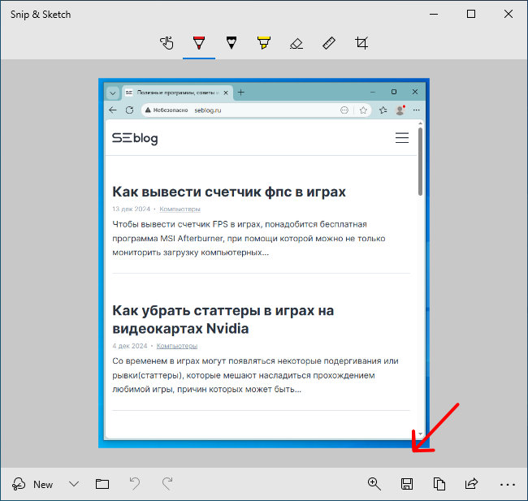

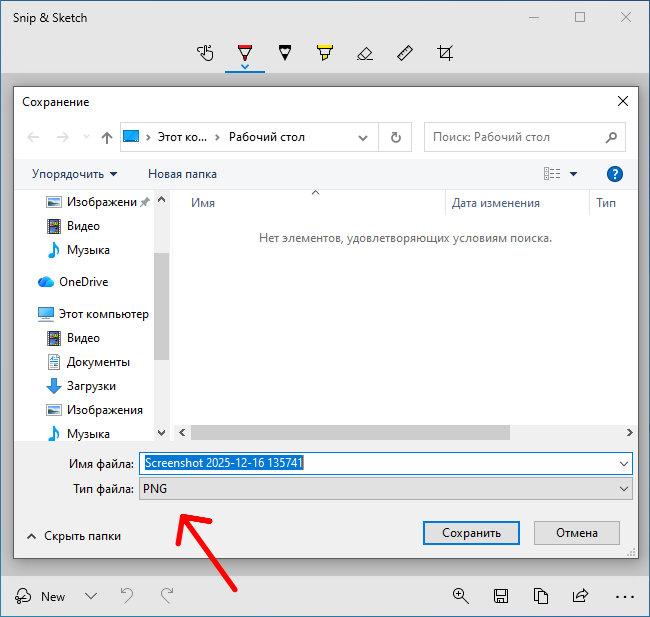